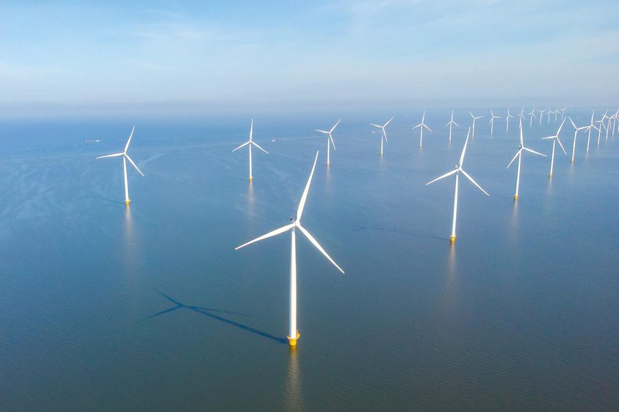
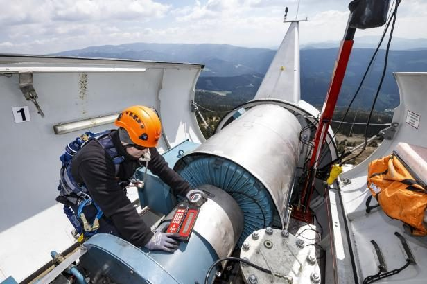
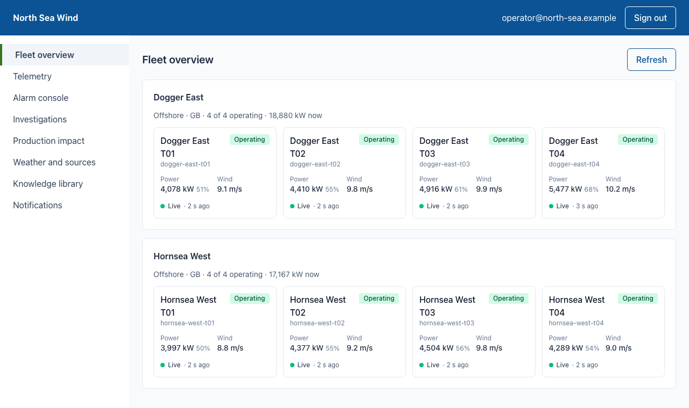
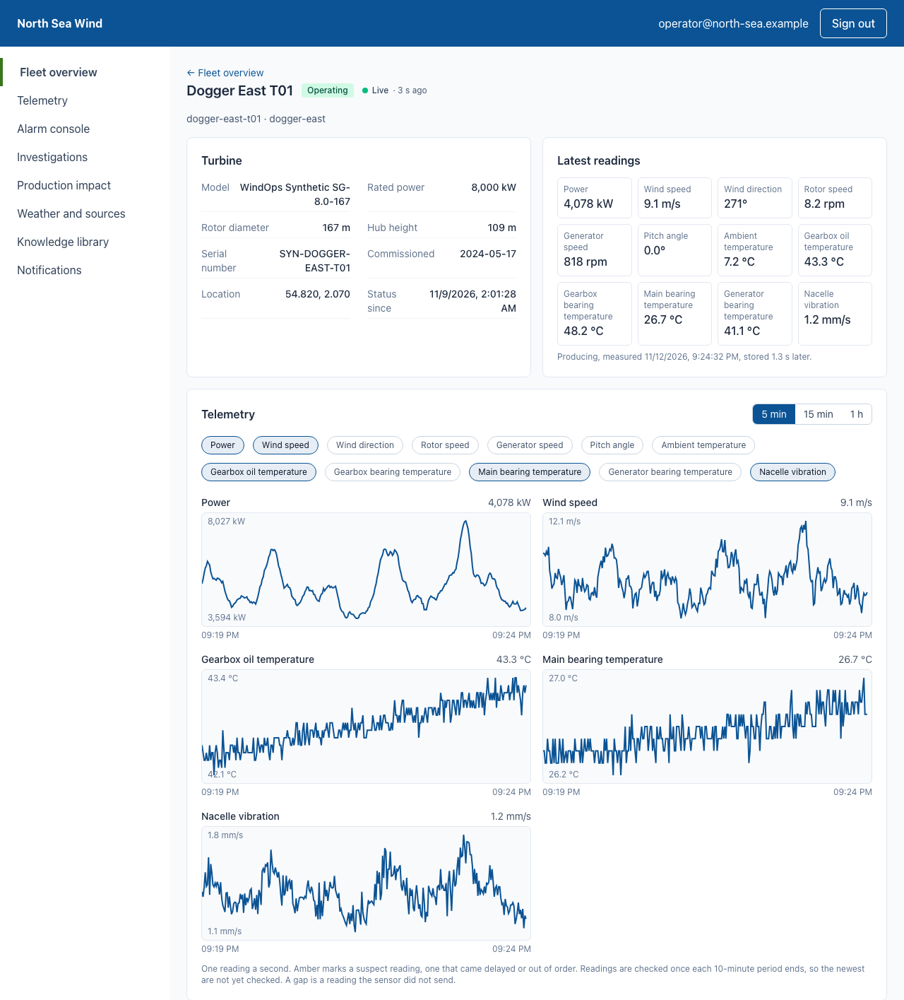

# WindOps AI: AI-Assisted Fault Investigation for Renewable Assets

[](https://github.com/wasif1024/windops-ai/actions/workflows/ci.yml)
[](https://github.com/wasif1024/windops-ai/actions/workflows/codeql.yml)

**Agentic AI that investigates equipment faults and prepares maintenance for renewable energy operators,
built first for wind farms.** AI agents interpret operational complexity, deterministic services enforce the rules
that matter, and authorized people approve every high-impact action, for each tenant separately.

The platform is advisory only: it never issues turbine commands. It is a portfolio-grade reference system, built
to production standards and run on synthetic data from a seeded, physics-based turbine simulator.

**Status:** Phases 1 to 3 and 4A are complete. The platform is **deployed and proven on Azure Kubernetes Service**
by its Azure DevOps pipeline, and runs the same way on a laptop ([evidence](docs/phases/phase-04a-exit-gate.md)).

<table>
  <tr>
    <td width="33%"></td>
    <td width="33%"></td>
    <td width="33%"></td>
  </tr>
  <tr>
    <td align="center"><sub><b>The assets:</b> turbines and whole wind farms</sub></td>
    <td align="center"><sub><b>The field work:</b> inspection and maintenance</sub></td>
    <td align="center"><sub><b>The users:</b> control room operators</sub></td>
  </tr>
</table>

<sub>Illustrative images of the industry this project serves. None shows WindOps AI or its output.
The control room image is a concept illustration: its figures, safety certification label and screens are
not claims about this project, which holds no certifications.</sub>

## Architecture

[![WindOps AI on Azure Kubernetes Service, in the style of Azure's reference diagrams, with a marker on each pod: green for running on Azure today, amber for running locally and on Azure in Phase 15, grey for planned. Client apps reach Application Gateway with its WAF, then an internal load balancer, then the APISIX gateway pod, the ingress, in the windops-system namespace, with the React frontend, Web BFF, Identity, Authorization, Tenant and Keycloak pods. Web BFF calls the back-end services over gRPC: one pod per domain service in windops-application, from Asset and Telemetry to Audit and Evaluation, colored by whether it is a service, a deterministic decision or a human decision, and the Agent Runtime, which pod autoscaling adds replicas of. The windops-mcp namespace holds the agents' four MCP servers, and the utility services are Redis, Qdrant, the OpenTelemetry Collector, the managed Prometheus agent, the Key Vault CSI driver and cert-manager. The back end uses Azure Database for PostgreSQL, a database and Entra login per service, and Azure Service Bus. Azure Pipelines pushes images to Azure Container Registry, which the cluster pulls from, and applies the Kustomize manifests. Dev/Ops and the cluster use Microsoft Entra ID for role-based access control and Workload ID; the Collector and Prometheus agent send to Azure Monitor, and the CSI driver reads Azure Key Vault.](docs/assets/kubernetes-on-azure.png)](docs/assets/kubernetes-on-azure.png)

<sub>A request comes in through Application Gateway's WAF to the APISIX gateway, the only way into the cluster.
Each service runs as its own pod, in a namespace by role, and reaches managed Azure services with its own Entra
identity and no stored secret. The markers show what runs where today: **green**, on Azure, deployed and proven
by the pipeline; **amber**, running locally and on Azure with the full deployment in Phase 15; **grey**, planned.
They are worked out from the code, so the picture cannot drift. Select it for full size. The
[architecture document](docs/architecture.md) has the detailed diagrams: every service, the security controls on each
hop, and the staging deployment's resource groups.</sub>

### Key decisions

| Concern | Decision |
| --- | --- |
| Entry | Apache APISIX is the only way into the cluster: TLS, OIDC token checks, CORS allowlists and per-route rate limits. Devices use a separate route with their own credentials. On Azure, Application Gateway's WAF stands in front of it |
| Identity and access | Keycloak for sign-in, with MFA for administrators. Eight roles, scoped to a tenant, wind farm or turbine; the Authorization Service decides every action and denies by default |
| Service communication | 23 services, each with its own image, contracts and data. Synchronous calls use gRPC with versioned Protobuf, mutual TLS, a signed identity and a deadline |
| Events | Published through a transactional outbox in each service, so a change and its event commit together. NATS JetStream locally and Azure Service Bus on Azure, behind one interface and chosen by `WINDOPS_ENVIRONMENT`. Failed messages go to dead letters |
| Data | PostgreSQL with one database and login per service, and forced row-level security on every tenant table. Telemetry is partitioned by day (ADR 0003). Redis for cache and rate limits, Qdrant for vector search |
| Agents | LangGraph and Claude. Agents reach services only through authenticated, schema-validated MCP servers with per-agent allowlists, and can draft but never approve |
| Resilience | A circuit breaker per caller and dependency, bounded retries for idempotent calls only, and a documented fallback for every dependency (ADR 0004) |
| Observability | Locally, OpenTelemetry traces in Tempo, metrics in Prometheus with Alertmanager, logs through Fluent Bit to Loki, and Grafana dashboards. On Azure, the same signals go to Application Insights, Log Analytics, managed Prometheus and Managed Grafana |
| Deployment | Kubernetes with Kustomize overlays and Cilium networking. Minikube locally (ADR 0001); AKS on Azure, with Entra Workload ID and Key Vault in place of stored secrets (ADR 0006) |

## Agent orchestration


An investigation from detection to decision, as specified in [SRS section 5.4](docs/srs.md#54-workflow). A
deterministic rule raises the fault; the Supervisor delegates to five specialist agents, each limited to its own
allowlisted tools; the Policy Service checks the result; and a person approves or rejects the draft work order. The
animation illustrates the specified workflow, not a recording.

## The console today

The operations console as it runs now, against the simulator's live demo fleet. All the data is synthetic.

<table>
  <tr>
    <td width="50%"><a href="docs/assets/screens/fleet-overview.png"></a></td>
    <td width="50%"><a href="docs/assets/screens/turbine-detail.png"></a></td>
  </tr>
  <tr>
    <td><b>Fleet overview:</b> every wind farm and turbine, with its status, latest power and wind, and how fresh the reading is.</td>
    <td><b>Turbine detail:</b> the model, the latest readings, and live charts over 5, 15 or 60 minutes.</td>
  </tr>
</table>

The screens are responsive and work at phone size. `make frontend-check` captures them in a real browser on each run.

## Design principles

| Principle | What it means in the system |
| --- | --- |
| **Agents recommend, they never decide** | Agents investigate and draft. The Policy Service, the Approval Service and authorized people make every decision that matters |
| **Deterministic where it counts** | Fault detection, production impact and policy checks are versioned rules with tests, not model output |
| **Evidence before conclusions** | Every investigation works from an immutable evidence snapshot, and every claim must cite its source |
| **Tenant isolation by construction** | The tenant comes from a verified identity, never a request field, and the database enforces it with row-level security |
| **Fail safe, and visibly** | Each dependency has a defined failure behavior: refuse, pause or continue, behind a circuit breaker (ADR 0004) |
| **Observable end to end** | Every request carries one trace ID through logs, metrics and traces, from the gateway to the database |

## Running on Azure

WindOps AI follows Azure's [advanced AKS microservices architecture](https://learn.microsoft.com/en-us/azure/architecture/reference-architectures/containers/aks-microservices/aks-microservices-advanced),
and runs the same platform on a laptop. Each service keeps its code, and `WINDOPS_ENVIRONMENT` chooses the back ends
behind it ([ADR 0006](docs/adr/0006-azure-aligned-platform-services.md)):

| Concern | Locally (`local`, `ci`) | On Azure (`dev`, `staging`, `live`) |
| --- | --- | --- |
| Cluster | Minikube with Cilium | AKS with Azure CNI Overlay, powered by Cilium |
| Way in | APISIX | Application Gateway WAF v2, then APISIX |
| Events | NATS JetStream | Azure Service Bus: topics, filtered subscriptions and dead-letter queues |
| Database | PostgreSQL pod, a password per service | Azure Database for PostgreSQL, Entra sign-in with no password |
| Secrets | Kubernetes Secrets | Key Vault, through Entra Workload ID and the Secrets Store CSI driver |
| Images | Built into Minikube | Azure Container Registry |
| Monitoring | Prometheus, Loki, Tempo and Grafana | Managed Prometheus, Log Analytics, Application Insights and Managed Grafana |

### Proven on Azure

On 2026-11-12 the pipeline deployed the `staging` environment in Sweden Central from the Bicep, put the services that
need only Azure's services on AKS, proved them, and removed the compute
([evidence](docs/phases/phase-04a-exit-gate.md)):

| Proven | How |
| --- | --- |
| Events on Azure Service Bus | The same five-scenario contract NATS passes, signed in with Entra and no keys |
| PostgreSQL with no password | Each service's migrations signed in as its own Entra identity, made by a Job running as the server's Entra administrator |
| Secrets from Key Vault | Every service read its Secrets through the CSI driver, and no pod was given a password |
| Our own service security | cert-manager issued certificates from the CA kept in Key Vault, and services called each other over mutual TLS with a signed identity |
| Azure Monitor | One trace followed a request across two services in Application Insights, and container logs reached Log Analytics |

### Cost

The [Azure deployment plan](docs/azure-plan.md) sizes and prices every resource. The compute exists only while it is
used:

| Profile | What runs | Cost |
| --- | --- | --- |
| Idle | The data resource group: Service Bus, PostgreSQL storage, Key Vault, the registry and monitoring | about $20 a month |
| **Proof run** | The pipeline deploys, proves and removes the compute: about two hours | **about $2.50 a run** |
| Demo | The compute for about 60 hours a month | about $98 a month |
| Always on | Everything, all month | about $938 a month |

## CI/CD

**GitHub Actions checks** every pull request and every merge to `main`. **Azure Pipelines deploys** what is merged.
Pull requests never deploy, and the deploy never runs unchecked code.

```text
pull request ──► GitHub Actions: check, frontend, dependency-audit, image-scan, secrets, CodeQL, pr-status
      │
   merge to main (by the maintainer)
      │
      ▼
Azure Pipelines ──► Validate ──► approval ──► Deploy ──► Platform ──► Prove ──► Remove compute
                    what-if,     you agree    the Bicep  services    Workload   always: back to
                    quota (free) to the cost  on Azure   on AKS      ID, traces about $20 a month
```

The pipeline signs in to Azure by workload identity federation, so no password or key is stored, and its identity
may grant only the roles the Bicep uses. Remove compute runs even when a stage fails or the run is cancelled, and
a nightly pipeline stops PostgreSQL when no cluster uses it. [Deploying with Azure DevOps](docs/azure-devops.md)
explains each stage, what Prove checks, how to read a deleted cluster's logs with `make azure-logs`, and the one-time
setup.

### What every pull request must pass

[.github/workflows](.github/workflows) holds three workflows. Every action is pinned to a commit, and each job gets
only read access unless it needs more.

| Job | What it proves |
| --- | --- |
| `check` | `make check`: lint, formatting, types, tests, contracts and generated files match the code |
| `frontend` | The web app's lint, types, tests and build, and `npm audit` |
| `dependency-audit` | No Python dependency has a known vulnerability |
| `image-scan` | A service built from the scaffold has no fixable high or critical CVE (Trivy) |
| `secrets` | Gitleaks finds no secret in the history |
| `codeql` | CodeQL's security analysis of the Python, also weekly |
| `pr-status` | The pull request's status label, and that it is ready to merge |

## Project status

| Phase | State |
| --- | --- |
| 1. Platform foundation | Done, [exit gate](docs/phases/phase-01-exit-gate.md) |
| 2. Data and events | Done, [exit gate](docs/phases/phase-02-exit-gate.md) |
| 3. Identity and tenancy | Done, with a sweep of every route and 17 checks at its gate |
| 4A. Azure alignment | Done, [deployed and proven on Azure](docs/phases/phase-04a-exit-gate.md) |
| 4. Assets and telemetry | Done, [exit gate](docs/phases/phase-04-exit-gate.md) |
| 5. Alarms, detection and cases | Done, [exit gate](docs/phases/phase-05-exit-gate.md) |
| 6. Deterministic decisions | Next: M6.1, the Policy Service |

| Running today | |
| --- | --- |
| Edge | API Gateway, Web BFF and the React frontend, with Keycloak sign-in and MFA |
| Identity and tenancy | Identity, Authorization and Tenant services, with tenant branding and administration consoles |
| Operations | Asset Service with synthetic demo fleets, and Telemetry Service with authenticated device ingestion, fed live by the simulator's 13 devices |
| Platform | Audit Service, with a tamper-evident trail, plus PostgreSQL, Redis, Qdrant, NATS JetStream and the full observability stack |
| On Azure | Asset, Audit, Authorization and Tenant on AKS, with Service Bus, Azure Database for PostgreSQL, Key Vault and Azure Monitor |

The [implementation tracker](docs/phases/README.md) lists every phase and module, and what is finished.

## Getting started

### Prerequisites

Docker Desktop, Minikube, kubectl, [uv](https://docs.astral.sh/uv/), [Buf](https://buf.build/docs/installation/),
Node.js 24 and Make. `make dev` checks for each and explains how to install anything missing.

### Run the platform locally

One command runs the backend and the frontend together:

```bash
make dev                       # or scripts/dev/dev.sh
scripts/dev/dev.sh --rebuild   # after pulling backend changes
scripts/dev/dev.sh --trust-ca  # macOS, once: trust the cluster's local CA in the browser
```

It installs the locked Python packages and the frontend's dependencies when they are missing or out of date, starts
the Minikube cluster, and on the first run deploys every workload and seeds the demo tenants, users and assets.
Then it serves:

| Address | What it is |
| --- | --- |
| http://localhost:5173/?tenant=north-sea | The frontend with live reload |
| https://localhost:9443/?tenant=north-sea | The frontend as deployed in the cluster |

Sign-in goes to Keycloak through the gateway, with a certificate from the cluster's own CA. Without `--trust-ca`, the
browser warns once. `make demo-logins` shows the demo users' passwords, and administrators set up an authenticator
app at first sign-in. Ctrl+C stops both servers and leaves the cluster running; `make cluster-stop` frees its
memory. [infrastructure/minikube](infrastructure/minikube/README.md) covers the cluster in detail.

### Develop and verify

```bash
make install   # install the locked development tools
make check     # lint, formatting, type checks, contract checks and tests
make service NAME=example-service   # create a service from the template
make help      # list every command, including the cluster checks
```

Every pull request must pass lint, type checks, tests, CodeQL, a dependency audit, and secret and image scans.
The [coding standards](docs/coding-standards.md) set the merge rules.

### Settings and provider keys

Every value that differs between environments is a setting, so changing one never needs a code change.
[.env.example](.env.example) lists them all with local defaults. `make dev` copies it to `.env` on the first run and
adds new settings later, keeping your values. Git ignores `.env`, and images never contain it.

| Setting | Purpose |
| --- | --- |
| `WINDOPS_PUBLIC_URL` | The gateway's public address, used by Keycloak, token issuers and the browser |
| `WINDOPS_ALLOWED_ORIGINS` | Other browser origins allowed to call the API and sign in, such as the dev server |
| `WINDOPS_KEYCLOAK_REALM`, `WINDOPS_OIDC_AUDIENCE`, `WINDOPS_WEB_CLIENT_ID` | The Keycloak realm, the API's token audience and the browser's client |
| `WINDOPS_ENVIRONMENT`, `WINDOPS_VERSION`, `WINDOPS_LOG_LEVEL` | The release, as logs and traces report it |
| `WINDOPS_*_ADDRESS`, `WINDOPS_OTLP_ENDPOINT`, `WINDOPS_KEYCLOAK_INTERNAL_URL` | Addresses inside the cluster |
| `WINDOPS_KUBE_CONTEXT`, `WINDOPS_DEV_PORT` | Local machine only: the kubectl context and the dev server's port |

After a change, run `make config`. It loads the settings into the `windops-settings` ConfigMap that every workload
reads, and restarts them. Changes to the public address or origins also need `make gateway-routes` and
`make identity-seed`; `make dev` runs both. Settings resolve from the process environment first, then `.env`, then
`.env.example`, so CI and the Azure pipeline set the same names as pipeline variables. On Azure, secrets come from
Key Vault, never from settings.

A setting is never a secret: `make config` refuses any name ending in `_KEY`, `_SECRET`, `_PASSWORD` or `_TOKEN`.
Generated credentials live in Kubernetes Secrets (`make secrets`). Security rules, such as TLS verification, the
Content Security Policy and the SRS rate limits, are not settings, so no value can turn them off. Provider keys stay
blank until a module needs one; add yours to `.env`, and never paste a real key into an issue, pull request or
`.env.example`.

## Documentation

| Document | What it covers |
| --- | --- |
| [Software requirements (SRS v1.1)](docs/srs.md) | Scope, fixed decisions, requirement IDs and acceptance criteria. The source of truth |
| [Implementation tracker](docs/phases/README.md) | Every phase and its modules, with progress and exit gates |
| [Phase 4 evidence](docs/phases/phase-04-exit-gate.md) | A seeded fault streamed into storage, every label matched to its ground truth, and every Phase 4 check |
| [Phase 4A evidence](docs/phases/phase-04a-exit-gate.md) | The platform deployed and proven on Azure, and the phase gates run again on Cilium |
| [Architecture](docs/architecture.md) | How a request flows, and the detailed diagrams of every service, control and Azure resource |
| [Microservices](docs/microservices.md) and [service map](docs/service-map.md) | Every service's calls and events, and its behavior when a dependency fails |
| [gRPC contracts](docs/grpc-contracts.md) and [events](docs/events.md) | Versioning, breaking changes, subjects, dead letters and alerts |
| [Security](docs/security.md) and [roles and permissions](docs/rbac.md) | Identities, tenants, data protection and the API, and who may do what |
| [Observability](docs/observability.md) | Data flow, dashboards, alerts and retention |
| [Deployment](docs/deployment.md) | Bootstrapping and running on Kubernetes |
| [Azure deployment plan](docs/azure-plan.md) | Every Azure resource with its size and monthly price, and how to stop paying for it |
| [Deploying with Azure DevOps](docs/azure-devops.md) | The pipeline that deploys and proves staging, and its one-time setup |
| [Coding standards](docs/coding-standards.md) | Naming, commits, pull requests, merge rules and automated enforcement |

### Architecture decision records

| ADR | Decision |
| --- | --- |
| [0001](docs/adr/0001-local-minikube-profile.md) | A local Minikube profile that runs every workload on a 16 GB laptop |
| [0002](docs/adr/0002-trace-storage-and-kube-state-metrics.md) | Tempo for trace storage, and kube-state-metrics |
| [0003](docs/adr/0003-postgresql-without-timescaledb.md) | PostgreSQL without TimescaleDB, and the local and production database designs |
| [0004](docs/adr/0004-failure-behavior-for-every-dependency.md) | A defined failure behavior for every dependency |
| [0005](docs/adr/0005-azure-deployment-as-the-final-phase.md) | Azure deployment as the final phase, and the services it uses |
| [0006](docs/adr/0006-azure-aligned-platform-services.md) | The platform aligned with Azure's reference architecture: Service Bus, Workload ID, Cilium and Azure Monitor |
| [0007](docs/adr/0007-alarms-arrive-through-the-device-route.md) | Alarms arrive through the device route, as `alarm.reported` events |
| [0008](docs/adr/0008-services-act-as-themselves-with-fixed-read-grants.md) | Services act as themselves, with fixed read-only grants |

## Repository layout

| Path | Contents |
| --- | --- |
| `frontend/` | React and TypeScript application |
| `services/` | The 23 services, each with its own image, contracts and data boundary |
| `simulator/` | Seeded turbine physics, fault profiles, data problems and scenarios with ground truth |
| `mcp-servers/` | Agent-facing tool servers |
| `agents/` | Supervisor and specialist agent definitions |
| `skills/` | Agent skills |
| `evaluations/` | Datasets, evaluators and regression runs |
| `shared/` | Protobuf contracts and cross-cutting libraries |
| `infrastructure/` | Kubernetes, Minikube, gateway, security and observability configuration |
| `docs/` | Requirements, design documents and architecture decision records |
| `tests/` | Cross-service tests |
| `scripts/` | The commands behind `make`, by role: setup, checks by phase, gates, dev tools and generators. See [scripts/README.md](scripts/README.md) |
