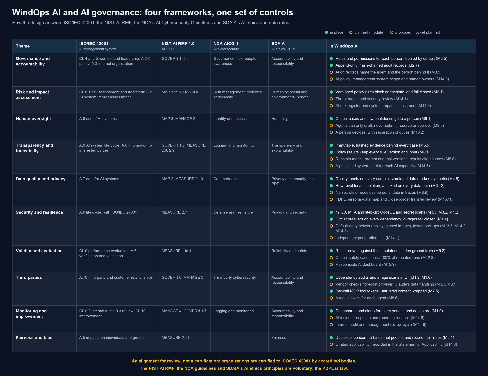

# AI governance: how WindOps AI aligns with ISO/IEC 42001, the NIST AI RMF, the NCA and SDAIA

This page maps the platform's design to four AI governance sources, and names what is still missing and where the plan delivers it. It is an
alignment for review, not a certification or a legal opinion. Nothing here claims that WindOps AI, or anyone running
it, conforms to a standard or complies with a law.

`scripts/generate/governance_view.py` draws the picture. Each control cites the tracker modules that deliver it, and
its marker comes from the [tracker](phases/README.md): in place once every cited module is done, planned until then,
and proposed when nothing in the plan does it yet.

## The sources

| Source | From | What it is | Binding? |
| --- | --- | --- | --- |
| [ISO/IEC 42001:2023](https://www.iso.org/standard/42001) | ISO and IEC | A management system standard for organizations that build, provide or use AI. Clauses 4 to 10 set the management system; Annex A has 38 controls in nine areas, A.2 to A.10. Chosen through a Statement of Applicability | No, but an organization can be certified to it by an accredited body |
| [NIST AI RMF 1.0](https://nvlpubs.nist.gov/nistpubs/ai/NIST.AI.100-1.pdf), AI 100-1 | US NIST, January 2023 | A risk framework: four functions, GOVERN, MAP, MEASURE and MANAGE, in 19 categories, and seven characteristics of trustworthy AI | No, voluntary |
| [AI Cybersecurity Guidelines, AICG-1: 2026](https://istitlaa.scbc.gov.sa/en/Security/nca/AICG/Pages/default.aspx) | Saudi National Cybersecurity Authority | Cybersecurity across an AI system's life cycle, from design to retirement, including generative and agentic AI. 4 domains, 15 subdomains and 42 guidelines: governance, defense, resilience and third parties | Not mandatory, according to its page. It is published on Istitlaa, the public consultation platform, last updated 5 July 2026 |
| [SDAIA's regulations and policies](https://sdaia.gov.sa/en/SDAIA/about/Pages/RegulationsAndPolicies.aspx) | Saudi Data and AI Authority | The AI Ethics Principles (2023): fairness, privacy and security, humanity, social and environmental benefit, reliability and safety, transparency and explainability, and accountability and responsibility. The Generative AI Guidelines (January 2024). The Personal Data Protection Law (PDPL), which SDAIA oversees | The principles and guidelines are guidance. The PDPL is law |

[PECB's ISO/IEC 42001 Lead Auditor](https://pecb.com/en/education-and-certification-for-individuals/iso-iec-42001/iso-iec-42001-lead-auditor)
course certifies a person, not a system: it trains auditors of AI management systems, under ISO 19011 and ISO/IEC
17021-1. It doesn't change the platform, but it is the role that would read this page.

Two of the pages could not be read directly when this was written: iso.org refuses automated requests, and the
ISO/IEC 42001 text is sold, not published. So the ISO references here are to clause and control areas, paraphrased,
never quoted, and should be checked against a licensed copy. SDAIA's page refused automated requests too, so its
entries come from SDAIA's published documents as reported elsewhere.

## What it means for WindOps AI

- **The software can't be certified; an organization can.** ISO/IEC 42001 certifies an organization's AI management
  system. WindOps AI is the AI system such an organization would run. What the project can do is make that
  organization's audit straightforward: controls built in, evidence produced by every check, and the documents an
  auditor asks for.
- **Most of what these sources ask for is already the design.** The SRS's design rules match them closely:
  - agents recommend, and deterministic services and authorized people decide;
  - human oversight for high-impact actions;
  - traceability of evidence, prompts, model versions, tool calls and approvals;
  - fail-closed behavior;
  - least privilege.
- **The gaps are mostly management, not code:** a policy, a risk register, an impact assessment, a Statement of
  Applicability, a system card, incident response, a PDPL data map, a penetration test, and an audit cycle.

## The crosswalk, theme by theme

Each theme lists what each source calls it, and how WindOps AI answers, with the check or document that proves it.

### Governance and accountability

ISO/IEC 42001 clauses 4 and 5 and A.2, A.3; NIST GOVERN 1, 2 and 4; NCA governance; SDAIA accountability.
- **In place:** deny-by-default roles and scoped grants (M3.5, `make authorization-check`), and an append-only,
  hash-chained audit trail (M2.7, `make audit-check`).
- **Planned:** audit records that name both the agent and the person or service behind it (M8.5, SEC-010).
- **Planned:** an AI policy, the management system's scope, and named owners for each AI capability (M14.6).

### Risk and impact assessment

ISO/IEC 42001 clause 6.1 and A.5; NIST MAP 1 to 5 and MANAGE 1; NCA risk management; SDAIA humanity and benefit.
- **In place:** the Policy Service blocks or escalates every proposal on versioned rules, and fails closed (M6.1,
  `make policy-check`, [ADR 0009](adr/0009-policy-judges-a-proposal-on-facts-it-gathers.md)).
- **Planned:** a threat model and security review (M14.1).
- **Planned:** an AI risk register, and an impact assessment for each AI capability: who it affects, how it can fail,
  and what limits it (M14.6).

### Human oversight

ISO/IEC 42001 A.9; NIST MAP 3 and MANAGE 2; NCA identity and access; SDAIA humanity.
- **In place:** critical cases and low-confidence recommendations escalate to a person (M6.1).
- **Planned:**
  - agents can only draft: every attempt to submit, reserve or approve as an agent is denied (M9.5);
  - a person decides, with separation of duties, so nobody approves their own request (M10.2).

### Transparency and traceability

ISO/IEC 42001 A.6 and A.8; NIST GOVERN 1.6 and MEASURE 2.8, 2.9; NCA logging and monitoring; SDAIA transparency.
- **In place:**
  - immutable, hashed evidence behind every case (M5.5, `make fault-case-check`);
  - policy results that keep every rule version and input (M6.1).
- **Planned:** every run pins its model, prompt and tool versions (AGT-004), and results cite their sources (M8.8).
- **Planned:** a published system card for each AI capability: purpose, inputs, limits, models, evaluation results
  and owners (M14.6).

### Data quality and privacy

ISO/IEC 42001 A.7; NIST MAP 2 and MEASURE 2.10; NCA data protection; SDAIA privacy and the PDPL.
- **In place:**
  - quality labels on every stored sample, with all simulated data marked synthetic (M4.6, `make data-quality-check`);
  - row-level tenant isolation, attacked on every data path (M3.12, `make cross-tenant-check`).
- **Planned:** no secrets or needless personal data in traces, with leakage tests (M8.9, OBS-003).
- **Planned:** a PDPL personal-data map and a cross-border transfer review (M15.10). The data is mostly turbine telemetry, not
  personal data, but users, approvers and audit records are personal data. Today the Azure staging deployment is in
  Sweden Central, and the Claude API is outside the Kingdom. A Saudi tenant needs a recorded decision on where its data
  may go.

### Security and resilience

ISO/IEC 42001 A.6, with ISO/IEC 27001; NIST MEASURE 2.7; NCA defense and resilience; SDAIA privacy and security.
- **In place:**
  - mutual TLS, MFA and step-up (M3.3, M3.2, `make mtls-check`, `make mfa-check`);
  - CodeQL and secret scans on every pull request (M1.2);
  - a circuit breaker on every dependency, with outages failing closed (M1.4).
- **Planned:** default-deny network policy (M13.3), signed images (M14.2), and tested backups (M14.3).
- **Planned:** an independent penetration test, which the NCA guidelines list (M14.1).

### Validity and evaluation

ISO/IEC 42001 clause 9 and A.6; NIST MEASURE 1 to 4; SDAIA reliability and safety.
- **In place:** fault rules proven against the simulator's hidden ground truth, and a gate at the end of every phase
  (M5.2, [Phase 5 gate](phases/phase-05-exit-gate.md)).
- **Planned:**
  - critical safety cases must pass 100% of repeated runs (M12.8, EVL-002);
  - a Responsible AI dashboard (M12.9).

### Third parties

ISO/IEC 42001 A.10; NIST GOVERN 6 and MANAGE 3; NCA third-party cybersecurity; SDAIA accountability.
- **In place:**
  - dependency audits and image scans in CI (M1.2, M1.6);
  - MCP tools behind per-call tool tokens, with untrusted content wrapped and labelled (M7.5).
- **Planned:**
  - vendor checks on the forecast provider and Claude's data handling (M6.3, M8.1);
  - a tool allowlist for each agent (M8.6).

### Monitoring and improvement

ISO/IEC 42001 clauses 9.2, 9.3 and 10; NIST MANAGE 4 and GOVERN 1.5; NCA logging and monitoring; SDAIA accountability.
- **In place:** dashboards and alerts for every service and data store (M1.9).
- **Planned (M14.6):**
  - an AI incident response and reporting runbook: what counts as an AI incident, who decides, and who is told;
  - an internal audit and management review cycle.

### Fairness and bias

ISO/IEC 42001 A.5; NIST MEASURE 2.11; SDAIA fairness.
- **In place:** WindOps AI makes recommendations about turbines, not people, and every decision records the rules it
  used (M6.1).
- **Planned:** record that limited applicability, with its reason, in the Statement of Applicability, rather than
  leave it unsaid (M14.6).

## What was added to the plan

The crosswalk's gaps were added to the [tracker](phases/README.md) on 2026-11-16:

| Deliverable | Answers | Module |
| --- | --- | --- |
| AI policy, management system scope and owners | ISO cl. 4–5, A.2, A.3; NIST GOVERN 1, 2 | M14.6 AI governance pack |
| AI risk register and system impact assessments | ISO cl. 6.1, A.5; NIST MAP; NCA risk management | M14.6 |
| Statement of Applicability | ISO cl. 6.1.3 | M14.6 |
| System cards | ISO A.8; NIST MEASURE 2.8, 2.9; SDAIA transparency | M14.6 |
| AI incident response runbook | ISO cl. 10; NIST MANAGE 4; NCA resilience | M14.6 |
| Internal audit and management review | ISO cl. 9.2, 9.3 | M14.6 |
| Penetration test | NCA defense; NIST MEASURE 2.7 | M14.1 Security review |
| PDPL data map, transfer review and residency decisions | SDAIA PDPL; NCA data protection | M15.10 PDPL and data residency |

## Keeping it current

- **When a module is done,** run `uv run python -m scripts.generate.readme_visuals`, which redraws this picture with
  the others. Controls whose modules are done turn from planned to in place.
- **When a new gap is found,** add it with `gap`, so it shows as proposed until a module plans it.
- **The tests:** `tests/test_governance_view.py` fails if a control cites a module the tracker doesn't have, or if a
  theme in the picture has no section here.
