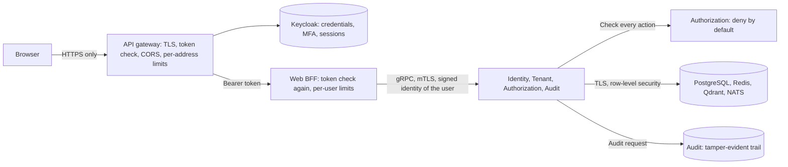

# Security

How WindOps protects identities, tenants, data and the API, and how to see that it is working. It covers SRS 9
and the SEC requirements in Phase 3. Roles and permissions are in [rbac.md](rbac.md).

## Identity and sign-in

| Control | How | Requirement |
| --- | --- | --- |
| One identity provider | Keycloak, one realm. It holds every credential and session. Nothing else stores a password | SEC-005, SEC-006 |
| Short-lived tokens | Access tokens last 5 minutes. Each refresh token works once, and is replaced | SEC-001 |
| Password policy | At least 12 characters with upper and lower case, a digit and a symbol, not the username, and none of the last 5 | SEC-004 |
| Lockout | After 5 failures, waits start at 1 minute and grow to 15 minutes. Failures are forgotten after 12 hours | SEC-004 |
| Sessions | Idle for 30 minutes, or 10 hours in all, ends a session. An administrator can end a user's sessions from the console | SEC-004 |
| MFA for administrators | Tenant and Platform Administrators set up TOTP (SHA-256, 6 digits, 30 seconds) and recovery codes at first sign-in | SEC-002 |
| Step-up | Every administrative change needs a second factor from the last 5 minutes. The API answers `step_up_required` (RFC 9470), and the console asks for a code only | SEC-003 |
| Tenant in every token | Keycloak Organizations put `tenant_id` in each token. A user of a suspended tenant gets none, so the gateway refuses them | SEC-005 |
| Token exchange | A user's token can be swapped for one lasting 2 minutes, for one allowed service such as the agent runtime | SEC-008 |

## Between services

| Control | How | Requirement |
| --- | --- | --- |
| Mutual TLS | Every gRPC call uses certificates from the cluster's own CA (cert-manager), which rotate by themselves | GRP-005 |
| The caller's identity | Web BFF signs a 60-second identity for the user it checked, including how and when they signed in. Services act on that, never on a field in the request | RBAC-001, GRP-004 |
| Deny by default | Every service asks Authorization before an action, and refuses if Authorization cannot answer | SEC-006, SRS 7.7 |
| Tenant isolation | Each service checks the tenant on every row it touches, and PostgreSQL's forced row-level security refuses another tenant's rows even if a query forgets | SEC-007, DAT-005 |
| Data stores | PostgreSQL, Redis, Qdrant and NATS accept only TLS, each with its own login per service | DAT-008 |

## The edge

| Control | How | Requirement |
| --- | --- | --- |
| HTTPS only | The gateway serves HTTPS at `WINDOPS_PUBLIC_URL`. Plain HTTP exists only inside its pod | API-001 |
| Tokens checked twice | The gateway checks each token's signature, issuer, audience and tenant, and Web BFF checks them again | SRS 7.2 |
| Rate limits | 5 sign-ins a minute and 600 API requests a minute per address at the gateway, and 120 a minute per user (300 for administrators) at Web BFF | SRS 7.5 |
| CORS | An explicit list of origins, `WINDOPS_ALLOWED_ORIGINS`, never a wildcard, and no cookies | API-005 |
| Browser | A strict Content Security Policy: everything from the page's own origin, no inline script, no framing. Tokens stay in memory, never in storage | SRS 9.5 |
| Errors | Every answer is in Web BFF's own words, with a fixed code. A service's message never reaches the browser | SRS 9.5 |

## Secrets and settings

- **Generated secrets** (database and data store logins, the gateway's admin key, the internal signing key) are made
  by `make secrets`, kept in files that git ignores, and given to pods as Kubernetes Secrets. In Azure they move to
  Key Vault (Phase 15).
- **Settings** are not secrets. `.env` holds them, and `make config` refuses a setting whose name ends in `_KEY`,
  `_SECRET`, `_PASSWORD` or `_TOKEN`. Security rules such as TLS verification and the CSP are not settings, so no value
  can turn them off. See [Settings and provider keys](../README.md#settings-and-provider-keys).
- **Provider keys** live only in `.env`, which images never receive.
- **CI** runs CodeQL, a secret scan (gitleaks), a dependency audit and an image scan on every pull request. Findings are
  fixed, never dismissed.

## Audit

Every denial, administrative change and break-glass use is recorded, in the same transaction as the change, through
each service's outbox to the Audit Service. Its records are append-only and hash-chained per tenant, so a changed
record is detected. Records name both the actor and the user they act for (SEC-010). Reading them needs
`audit.read`. See [the Audit Service](../services/audit-service/README.md).

## Seeing it: the Security dashboard

Grafana's Security dashboard (`make observability-forward`, then http://127.0.0.1:3000) shows the SRS 10.3
indicators:

| Panel | From |
| --- | --- |
| Failed sign-ins, and by reason | Keycloak's user events (`keycloak_user_events_total`) |
| Wrong passwords | Keycloak's password checks (`keycloak_credentials_password_hashing_validations_total`) |
| MFA failures | Wrong authenticator or recovery codes: refused credentials less wrong passwords. Keycloak reports both as the same error, and every wrong password also fails its password check |
| Access denials, by service | The audit trail (`windops_audit_records_total`, counted when a record is stored) |
| Rate-limited, at the gateway and at Web BFF | The gateway's answers by route and status, and Web BFF's per-user limit |
| Tokens refused at Web BFF | By reason: missing, invalid or without a tenant |
| Administrator changes | Users, roles, permissions, break-glass and tenants, from the audit trail |
| Suspicious tool calls | Arrives with the agents, in Phase 8 |

The counts carry no user or tenant, so they stay few. A count that Keycloak has only just started misses its first
event, because Prometheus has no earlier value to compare with: after Keycloak restarts, the first wrong password or
code is not shown. WindOps' own counts start at 0, so each alert sees the first event. Who did what is in the audit trail, which the administrator
console shows.

### Alerts

| Alert | When | Severity |
| --- | --- | --- |
| `WindopsManyFailedSignIns` | More than 20 failed sign-ins in 10 minutes | warning |
| `WindopsManyAccessDenials` | More than 20 access denials in 10 minutes | warning |
| `WindopsSustainedRateLimiting` | The gateway refused more than 100 requests for their rate in 10 minutes | warning |
| `WindopsBreakGlassStarted` | A Platform Administrator started break-glass access | info |
| `WindopsAdministratorRoleGranted` | A Tenant or Platform Administrator role was granted | info |

Each has `category: security`. Routing by severity and owner arrives in M13.7.

## Proving it

| Check | Proves |
| --- | --- |
| `make identity-check`, `make mfa-check` | The realm's rules, MFA set-up, step-up and recovery codes |
| `make mtls-check`, `make data-tls-check` | mTLS between services, and TLS on every data store, including a real certificate renewal |
| `make authorization-check`, `make cross-tenant-check` | Deny by default, scopes, break-glass, and that no API reaches another tenant |
| `make edge-check`, `make gateway-policy-check`, `make bff-check` | HTTPS, token checks, CORS and rate limits at the edge |
| `make admin-api-check`, `make platform-api-check`, `make frontend-check` | The consoles, with real sign-ins, step-up and refusals |
| `make security-check` | Each Security dashboard panel and alert has data behind it, from real refusals |

## Known limits

- **One signing key for internal identities.** Every service shares it. A per-service key, or tokens signed by
  Keycloak all the way through, would limit what one compromised service could do.
- **The gateway is not authenticated to Web BFF.** Network policies in M13.3 will let only the gateway reach it.
- **Rate limits are per gateway pod.** With more than one, each counts on its own.
- **The gateway's certificate is re-sent by hand** after cert-manager renews it: `make gateway-routes`, which `make
  dev` runs.
- **Custom domains are not proven yet**, and tenants are not served at them.
- **Behind a cloud load balancer**, the gateway must take the client's address from the forwarded header, or the
  per-address limits count the load balancer (Phase 15).
