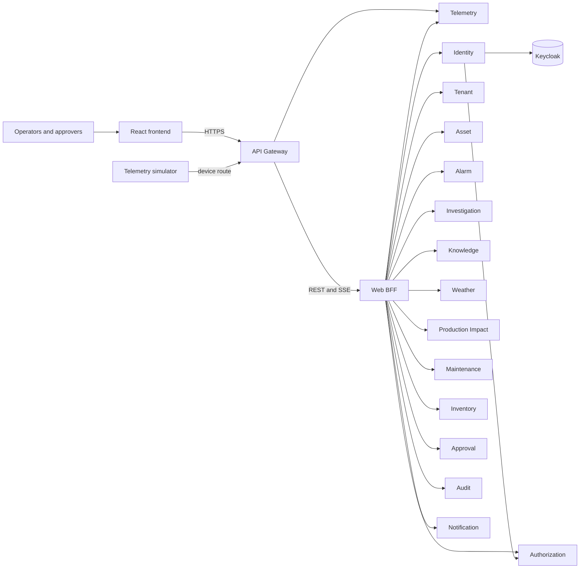
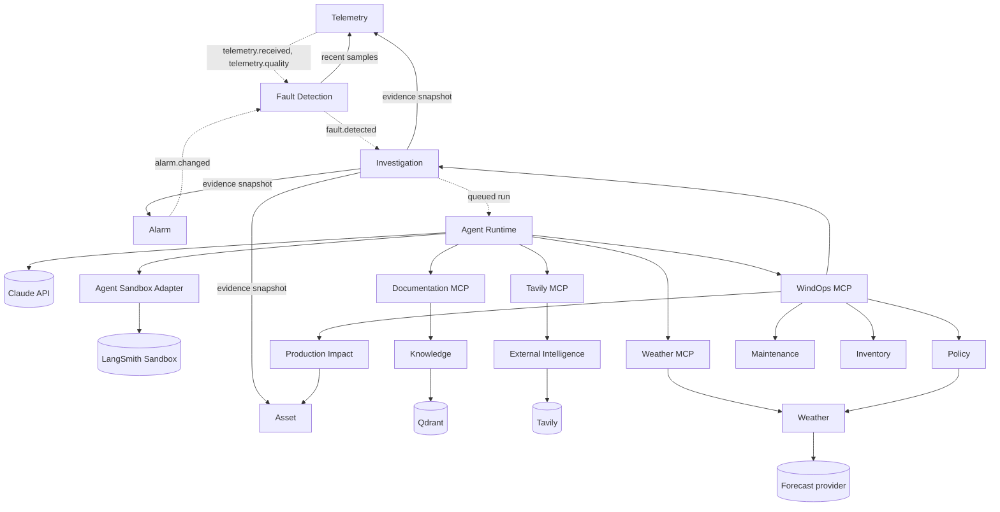
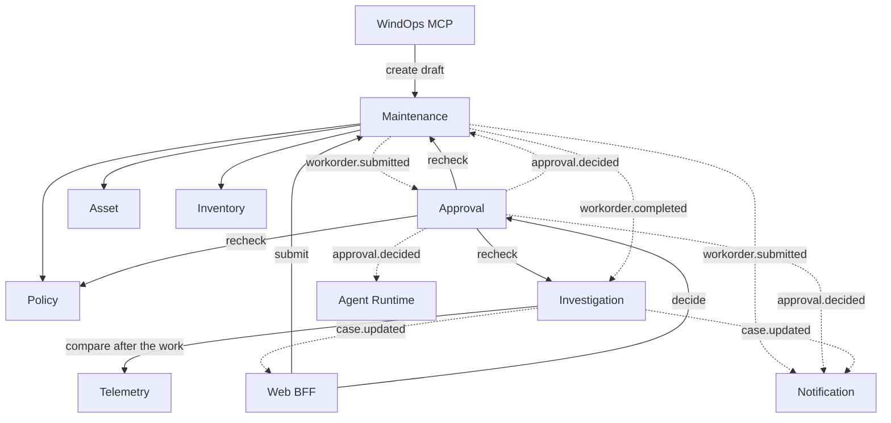
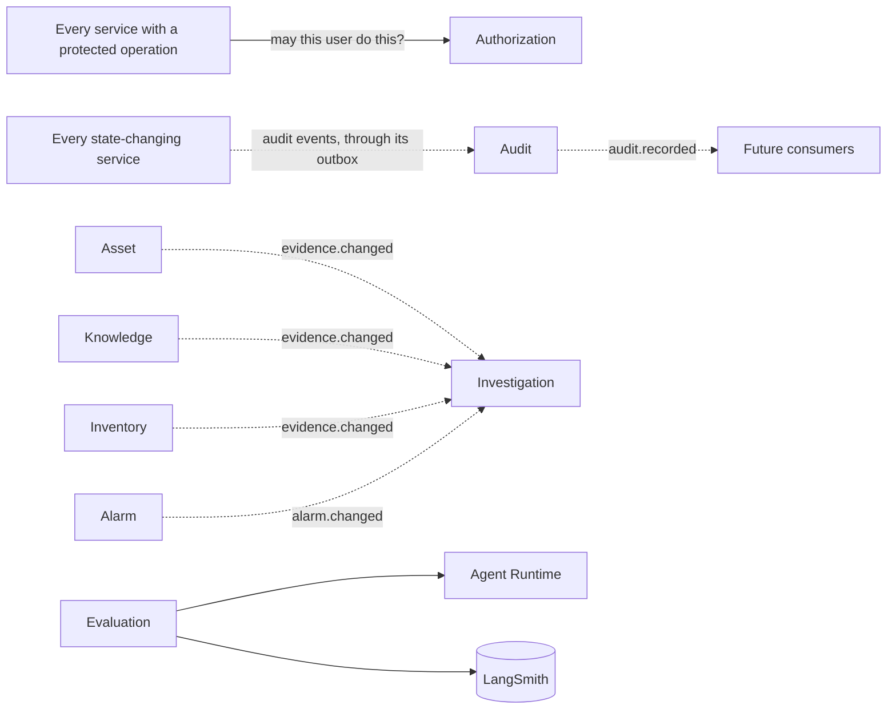
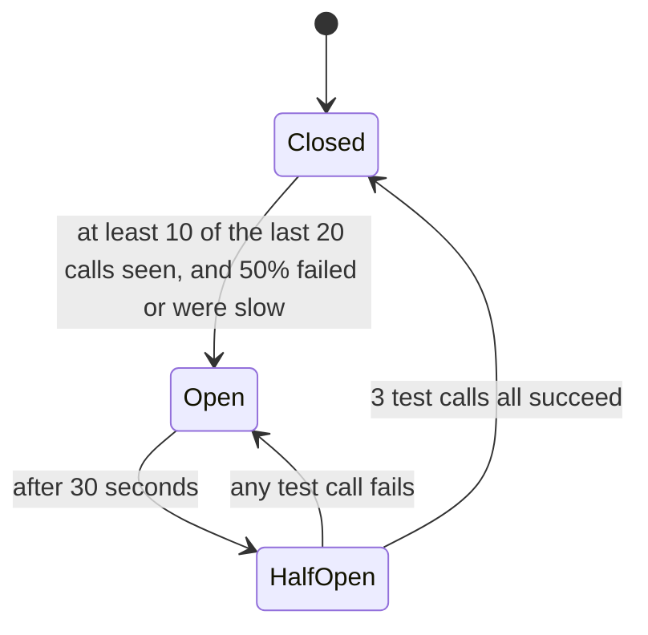

# Service map

This page shows how all 23 services connect, and what happens when one of them fails.

**How far to trust it:** the SRS defines the MCP calls, the workflow, who owns what and the failure
behaviors below. It does not list every service-to-service call, so the links here are a design
worked out from it. A module that builds a link confirms or corrects that link here, in its own pull
request. Today only the platform, the data stores, the Audit Service and the sample services run.

## How services connect

Solid lines are calls, where the caller waits for an answer. Calls between services use gRPC, and each
caller has its own circuit breaker for each dependency. Dotted lines are events or queued work through
NATS JetStream, where the sender does not wait.

Services never read each other's databases (ARC-002). They use only these links.

### 1. People and devices coming in

The browser and simulator reach only the API Gateway (API-001). Web BFF then calls the service behind
each screen.

### 2. From a fault to a recommendation

Fault Detection decides that something is wrong, with no LLM involved. Investigation freezes the evidence,
then Agent Runtime works through MCP servers, which are its only route to services.

WindOps MCP also has read tools for Asset, Telemetry and Alarm, which the table below lists.

### 3. From a draft to a finished job

Agents can only create drafts. A person submits the work order, and another person decides on it.

### 4. Links that touch many services

Investigation listens for changes because they can make a recommendation stale (SRS 8.5).

## Every service and its links

| Service | Calls | Publishes | Listens for |
| --- | --- | --- | --- |
| API Gateway | Web BFF and the Telemetry device route, over HTTP | None | None |
| Web BFF | The services behind each screen in SRS 4.11 | None | `case.updated`, for live progress |
| Identity | Keycloak, over its admin API, and Authorization | Audit events | None |
| Authorization | None | Audit events | None |
| Tenant | None | Audit events | None |
| Asset | None | `evidence.changed`, audit events | None |
| Telemetry | None | `telemetry.received`, `telemetry.quality` | None |
| Alarm | None | `alarm.changed`, audit events | None |
| Fault Detection | Telemetry | `fault.detected`, audit events | `telemetry.received`, `telemetry.quality`, `alarm.changed` |
| Investigation | Telemetry, Alarm, Asset | `case.updated`, queued runs, audit events | `fault.detected`, `alarm.changed`, `evidence.changed`, `workorder.completed` |
| Agent Runtime | MCP servers, Agent Sandbox Adapter, Claude | Audit events | Queued runs, `approval.decided` |
| Agent Sandbox Adapter | LangSmith Sandbox | None. Agent Runtime records sandbox use | None |
| Knowledge | Qdrant, the embedding provider | `evidence.changed`, audit events | None |
| Weather | The forecast provider | None | None |
| External Intelligence | Tavily | Audit events | None |
| Production Impact | Asset | Audit events | None |
| Policy | Weather | Audit events | None |
| Maintenance | Asset, Policy, Inventory | `workorder.submitted`, `workorder.completed`, audit events | `approval.decided` |
| Inventory | None | `evidence.changed`, audit events | None |
| Approval | Maintenance, Investigation, Policy | `approval.decided`, audit events | `workorder.submitted` |
| Audit | None | `audit.recorded` | `audit.requested.*`, the audit events from every service |
| Notification | Email provider | Audit events | `case.updated`, `workorder.submitted`, `approval.decided` |
| Evaluation | Agent Runtime, LangSmith | Audit events | None |

The telemetry simulator is a separate workload and reaches Telemetry through the gateway. The MCP
servers are also separate workloads, and call only these services (SRS 6.3):

| MCP server | Calls |
| --- | --- |
| WindOps MCP | Asset, Telemetry, Alarm, Investigation, Maintenance, Inventory, Production Impact, Policy |
| Documentation MCP | Knowledge |
| Tavily MCP | External Intelligence |
| Weather MCP | Weather |
| Filesystem MCP (development only) | Local fixtures |
| PostgreSQL MCP (development only) | A read-only diagnostic role |

## What a circuit breaker does

A breaker stops a service from waiting on a dependency that is failing. Calls fail straight away, the
caller's workers stay free, and the struggling dependency gets time to recover.

Each caller has its own breaker for each dependency. If Policy fails, Maintenance's breaker for Policy
and Approval's breaker for Policy each open on their own evidence, and neither affects calls to any
other service.

| State | What happens to a call |
| --- | --- |
| Closed | It goes to the dependency, and the result is counted |
| Open | It fails at once with `BreakerOpenError`, and the caller runs its fallback |
| Half-open | Up to 3 test calls go through, and any others fail at once |

These count against a dependency: `UNAVAILABLE`, `DEADLINE_EXCEEDED`, `RESOURCE_EXHAUSTED`, unexpected
`INTERNAL`, provider 429 and 5xx responses, and slow calls. These do not, because the dependency is
working and the request is the problem: `INVALID_ARGUMENT`, `NOT_FOUND`, `PERMISSION_DENIED` and
`UNAUTHENTICATED`.

A failed idempotent call is tried at most 3 times in total, with growing, randomized waits. Authorization
failures and non-idempotent calls are never retried blindly (RES-004). Every state change is logged and
exported as a metric, and a breaker left open too long raises an alert (RES-001).

### Example: Policy goes down during an investigation

1. Agent Runtime calls Policy through WindOps MCP, and the calls start failing.
2. Once at least half of the recent calls have failed, that caller's breaker opens and an alert can follow.
3. Further calls fail immediately instead of waiting for a timeout.
4. The fallback is to fail closed, so no recommendation can reach `pending_review`.
5. After 30 seconds, 3 test calls go through. If all succeed the breaker closes and checks work again. If
   any fails, it stays open for another 30 seconds.

Nothing unsafe gets through while Policy is down. The cost is that recommendations wait.

## What happens when each dependency is down

The fallback depends on what the dependency protects. Anything guarding safety or access fails closed,
and anything optional lets the work continue while recording the gap.

### Defined by SRS 7.7

| Dependency down | Defined behavior when the breaker opens |
| --- | --- |
| Anthropic API | Pause the run with a resumable status and notify the operator, without inventing findings |
| Tavily | Continue, and record external research as a data gap |
| Forecast provider | Mark weather unavailable; weather-dependent policy checks block or escalate |
| Knowledge or Qdrant | Pause evidence retrieval; do not produce uncited procedure claims |
| Telemetry or Alarm | Refuse a new snapshot; existing snapshots stay readable |
| Policy | Fail closed; no recommendation can reach `pending_review` |
| Authorization | Fail closed; deny the protected operation |
| Approval | Reject decisions and keep the queue readable if possible |
| Audit | Queue through the outbox; alert if the backlog passes its limit |
| Notification | Queue through JetStream; the workflow continues |
| LangSmith | Buffer or drop traces with an alert; the Audit Service remains authoritative |
| Sandbox | Mark the analysis unavailable and continue without it |
| Identity | Existing sessions keep working from their signed tokens; user changes are refused; screens show user IDs in place of names |
| Keycloak | New logins and token exchange fail; nothing falls back to weaker access |
| Tenant | Use the last known branding; refuse tenant changes and new tenants |
| Asset | Refuse new snapshots and work-order validation; existing snapshots stay readable |
| Fault Detection | Telemetry keeps being stored, and the events wait in JetStream; alert that detection is delayed |
| Investigation | Refuse new cases and approvals that need a snapshot check; fault events wait in JetStream |
| Agent Runtime | Queued runs wait, and running ones resume from their last checkpoint; no findings are produced |
| Weather Service | Same as the forecast provider above |
| External Intelligence | Same as Tavily above |
| Production Impact | Mark impact unavailable and block the recommendation until it returns; no agent may estimate figures |
| Maintenance | Refuse new drafts, submissions and approvals; keep the investigation's findings |
| Inventory | Mark part availability unknown, and refuse reservations; a plan cannot state that a part is available |
| Evaluation | Delay evaluation jobs, and do not count a skipped evaluation as passed; investigations are unaffected |
| Embedding provider | Pause ingestion and semantic search; do not return results that were not permission-checked |
| Email provider | Same as Notification above, with in-app notifications still delivered |
| PostgreSQL | The services that need it return `UNAVAILABLE` and write nothing; events already in JetStream wait |
| Redis | Work continues from the source service, more slowly; rate limits fail closed on protected routes |
| JetStream | State changes still commit, with their events held in the outbox until it returns |

## Where to read more

- [SRS 7.6](srs.md#76-events-and-consistency) and [SRS 7.7](srs.md#77-circuit-breaking-and-resilience): events and breaker requirements
- [Microservices](microservices.md): how to add a call with a breaker
- [Phase 1 exit gate](phases/phase-01-exit-gate.md): a real breaker opening under an injected fault
