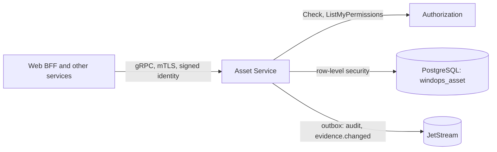

# windops-asset

Each tenant's wind farms, turbines and their components (FR-AST-001, FR-AST-002): where they are, what model and
manufacturer, their status, and the tree of parts down to the gearbox bearings. Telemetry, alarms, fault detection,
investigations and work orders all refer to its turbines.



## What it holds

| Record | Fields |
| --- | --- |
| Wind farm | ID, name, country, location, time zone, offshore or onshore, version |
| Turbine | ID, wind farm, name, location, model (manufacturer, model, rated power, rotor diameter, hub height), serial number, commissioning date, status and its reason, version |
| Component | Kind, parent component, name, manufacturer, model, serial number, installation date, status and its reason, version |

- **Turbine statuses:** `operating`, `curtailed`, `stopped`, `maintenance`, `fault` and `offline`. Any but `operating`
  needs a reason.
- **Component statuses:** `in_service`, `degraded`, `failed` and `removed`. Any but `in_service` needs a reason.
- **Component kinds:** `tower`, `nacelle`, `rotor`, `hub`, `blade`, `pitch_system`, `main_shaft`, `main_bearing`,
  `gearbox`, `gearbox_bearing`, `gearbox_oil_system`, `generator`, `generator_bearing`, `converter`, `transformer`,
  `yaw_system`, `cooling_system`, `controller` and `sensor`.
- **The tree:** a component's parent must be a component of the same turbine, and exists before it, so there is no
  cycle.

## Who may do what

| Call | Needs |
| --- | --- |
| Read a wind farm or turbine | `turbine.read` for its wind farm or the turbine itself |
| List wind farms or turbines | Shows only what the caller's `turbine.read` scopes cover (RBAC-002). A grant for one turbine shows its wind farm too |
| Create or update a wind farm or turbine, set a status, add a component or set its status | `asset.manage` for that wind farm or turbine, and a second factor from the last 5 minutes (SEC-003) |

The tenant comes from the caller's verified identity, never a request, and every table has forced row-level
security. Another tenant's assets answer as if they did not exist. If Authorization cannot answer, the call is
refused (SRS 7.7).

## Versions and events

A turbine's version rises with every change to it or to one of its components. Each change queues, in the same
transaction, an audit record and an `evidence.changed` event naming the turbine and its new version. Investigations
use it to mark evidence gathered at an older version stale (SRS 8.5). A create or change may be retried with the same
`idempotency_key`, which returns the first answer and changes nothing (GRP-007).

## Demo assets

`make asset-seed` records synthetic assets, marked as such by the manufacturer "WindOps Synthetic" (SIM-006):

| Tenant | Wind farms | Turbines |
| --- | --- | --- |
| north-sea | Dogger East and Hornsea West, offshore in the UK | 4 each, 8 MW |
| atlas-wind | Atlas Ridge, onshore in Spain | 5, 4.5 MW |

Each turbine has 21 components, including the gearbox with its high-speed and intermediate shaft bearings and oil
system, and the main and generator bearings. The IDs are fixed, so a second run changes nothing.

## Run the tests

```bash
uv run pytest services/asset-service/tests
make asset-check   # on the cluster: isolation, scoped reads, changes, the audit trail and evidence.changed
```

## Build the image

```bash
docker build -f services/asset-service/Dockerfile -t windops-asset:local .
```

## Limits

- **No deletes.** Records are changed, never deleted, as work orders and evidence refer to them. A removed part has
  the status `removed`.
- **Only people change assets.** Status changes from services, such as Fault Detection marking a turbine `fault`,
  arrive with their phases.
- **Every change announces evidence.changed**, including renames, which are not material. Consumers decide what
  matters.
