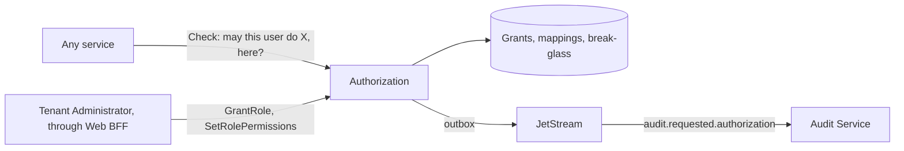

# windops-authorization

Decides what each user may do, and keeps their roles (SRS 7.2). It is the source of truth for roles,
permissions and scopes, while Keycloak holds credentials and sessions (SEC-006).



## Rules

| Rule | Where it is enforced |
| --- | --- |
| Anything not granted is denied, including an unknown permission | `policy.decide_in_tenant` |
| The user and tenant come from the verified identity (RBAC-001) | `Check` ignores no field, and naming another tenant moves nobody there |
| The eight roles and the SRS 3.2 matrix, row for row | `policy.DEFAULT_MATRIX`, which a test compares with `docs/srs.md` |
| A grant may cover a tenant, a wind farm or a turbine (RBAC-002) | `policy.covers` |
| A tenant may change its roles' permissions, but never give one a platform permission | `policy.check_mapping` |
| The last Tenant Administrator cannot be removed, nor lose `roles.manage` | `RevokeRole`, `policy.check_mapping` |
| Granting, revoking and changing permissions need a second factor in the last 5 minutes (SEC-003) | `windops-auth` |
| A Platform Administrator reads a tenant's data only through break-glass (RBAC-003) | `policy.decide_across_tenants` |
| Break-glass needs a reason of 20 characters, lasts 1 to 240 minutes, and only reads | `policy.check_break_glass` |
| Every denial, change and break-glass use is audited, in the same transaction | `store.audit` and the outbox |

Ended grants stay, with who ended them and when, so the Approval Service can check the roles someone held
at the time of a decision (RBAC-005, RBAC-006).

## The first administrators

Nobody can grant the first role, so `make authorization-seed` runs the bootstrap command inside the pod:

```bash
kubectl exec deployment/windops-authorization --namespace=windops-system -- \
    python -m windops_authorization.bootstrap --tenant north-sea --user <keycloak-id> --role tenant-administrator
```

It cannot create a Platform Administrator in a customer tenant, and each use is audited.

## Check it

```bash
uv run pytest services/authorization-service/tests
make authorization-check   # on the cluster
```

## Limits

- **No caller uses it yet.** Services call `Check` as they are built, starting with the Identity Service in M3.4.
  Until a service does, its own operations are not protected by these rules.
- **A step-up claim from Web BFF.** The second-factor check reads `acr` and `auth_time` from the signed internal
  identity. Web BFF copies them from the user's verified Keycloak token in M3.7, and until then only checks sign
  them.
- **Unchecked user IDs.** A grant names a user ID that is not checked against Keycloak, because this service must
  not depend on the Identity Service. The Identity Service ends a user's grants when it disables them (M3.4).
- **No break-glass reason in the audit chain.** The break-glass reason is stored here, not in the audit chain, whose
  record has no field for it. The audit record names the grant.
- **Decisions are not cached.** Each one reads the database, which is fine at this size, and keeps a revoked role
  from working a moment longer.
