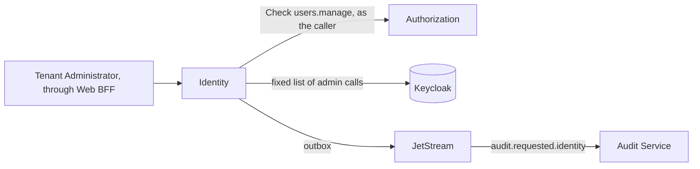

# windops-identity

Manages a tenant's users in Keycloak: creating, disabling and reactivating them, ending their sessions, and showing
their MFA status (SRS 7.2, SRS 9.4). Keycloak holds the credentials and sessions, and the Authorization Service
decides who may manage them (SEC-006).



## Rules

| Rule | How |
| --- | --- |
| Every call needs `users.manage` from the Authorization Service, asked as the caller | `AuthorizationClient` |
| Authorization down means refused, never allowed (SRS 7.7) | Any failure to ask becomes `UNAVAILABLE` |
| Every change needs a second factor in the last 5 minutes (SEC-003) | `windops-auth` |
| A user is always checked against the caller's tenant | Another tenant's user gets the same `NOT_FOUND` as a user who does not exist (SEC-007) |
| A new user gets a temporary password, shown once and never stored, and must change it | `CreateUser` |
| A retried create returns the same user, never the password again (GRP-007) | The `created_users` table |
| Disabling a user ends their sessions, so their refresh tokens stop working (SEC-004) | `DisableUser` |
| An administrator cannot disable their own account | `DisableUser` |
| Every change is audited, once | The outbox |

## Token exchange (SEC-008)

`ExchangeToken` swaps the caller's own Keycloak access token for one that only the agent runtime accepts:

1. **Ask Keycloak whose token it is.** Keycloak introspects it, checking the signature, expiry and session, and it
   must be active, for the caller's own user and tenant. A service holding another user's token cannot exchange it.
2. **Exchange it,** as the `windops-api` client, for one allowed target, with that target's scope.
3. **Audit it,** as `identity.token.exchanged.<target>`.

The new token lasts 120 seconds, keeps the user and tenant, and names only the target. The token is never stored or
logged.

## Keycloak access

Keycloak lets nothing less than `manage-realm` read or change an organization's members, and organizations are our
tenants. That role could also change realm settings, so `keycloak.py` refuses any call outside a fixed list of user,
session, credential and membership endpoints. A test fails if that list changes, which makes it a reviewed security
change. The client's secret is given only to the `windops-system` namespace.

`make identity-seed` creates the `windops-identity-service` client and its Secret.

## Check it

```bash
uv run pytest services/identity-service/tests
make identity-service-check   # on the cluster
```

## Limits

- **A compromised service could change the realm.** If this service were compromised, its Keycloak key could change
  the realm, because Keycloak offers no narrower role for organizations. The allowlist limits only this code, not the
  key itself.
- **No password reset email.** There is no email server yet, so an administrator must pass on the temporary
  password. The Notification Service (Phase 11) can send an invitation instead.
- **Up to 5 minutes of access after disabling.** A disabled user's access token keeps working until it expires,
  because tokens are not checked against Keycloak on each call (SEC-001 keeps them short).
- **An unlikely gap after creating a user.** If the database fails right after Keycloak creates a user, the user
  exists but a retry is refused as a duplicate email. The administrator sees the user in the list.
- **The exchange key can exchange any user's token.** The `windops-api` client's secret could exchange any user's
  current token, so it lives only in this service's Secret. This service exchanges only the caller's own token,
  which Keycloak confirms first.
