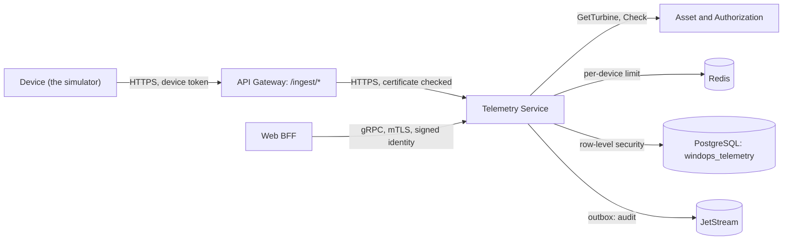

# windops-telemetry

Takes in each turbine's operational samples, as its device sends them, and keeps them by tenant and turbine
(FR-TEL-001, FR-TEL-002). Each device has its own credential, for one tenant and one turbine (FR-TEL-005). Fault
detection, data-quality labels, summaries and the fleet screens all read from it, as later modules add them.



## The device route (API-004)

`POST /ingest/v1/samples`, through the gateway, with `Authorization: Bearer <tenant>.<device>.<secret>` and a body of
`{"samples": [...]}`. Each sample is the simulator's schema version `2`; see
[windops-simulator](../../simulator/README.md#each-sample). The answer says how many were stored, and why each other
one was refused, by its place in the batch:

```json
{"accepted": 58, "rejected": [{"index": 12, "reason": "bad_event_time"}, {"index": 40, "reason": "not_json"}]}
```

| Answer | When |
| --- | --- |
| 200 | The batch was read. Samples that break the schema, or name another tenant or turbine, are refused one by one, and each refusal is kept with its reason and the start of what was sent (FR-TEL-003) |
| 401 `bad_credential` | No credential, a wrong or revoked one. Every way of failing gets the same answer |
| 429 `too_many_requests` | More than 600 requests in a minute from this device (SRS 7.5), with `Retry-After` |
| 503 `unavailable` | The rate counters cannot be reached, so the request is refused rather than let through |
| 400 `not_json`, `no_samples` | The body is not JSON, or has no `samples` list |
| 413 `too_large`, `too_many_samples` | More than 1 MiB, or more than 600 samples |

Errors are RFC 9457 problems, and never repeat what was sent. The route is served only over TLS, on port 8443: the
plain port, 8080, has health and metrics only. The gateway has no user sign-in on `/ingest/*`, only a coarse
per-address limit.

## What it stores

| Table | What | Partitions | Kept (SRS 8.3) |
| --- | --- | --- | --- |
| `operational_samples` | One row per 1 Hz sample: tenant, turbine, event time, sequence, the device, ingestion time, source, schema and model versions, `synthetic`, state, availability, quality status and the 12 readings. A reading is null while its sensor sends nothing. Quality status is `received` until data-quality detection labels it (M4.6) | A day each, by event time | 90 days |
| `scada_summaries` | A 10-minute SCADA summary per turbine: mean, minimum, maximum and standard deviation of each reading, coverage, quality status, availability, producing time, energy, duplicates, late samples, revision and the versions it came from | A month each, by period | 2 years |
| `ingest_rejections` | Each refused sample, with its reason, at most 500 characters of what was sent, and its sequence and time if they can be read | None, deleted row by row | 90 days |
| `data_gaps` | Each run of sequences a turbine never sent, per 10-minute period | None, deleted row by row | 90 days |
| `retention_holds` | Ranges of data a snapshot references, kept past retention until released. Snapshots write them from M4.7 | None | Until released |
| `device_credentials` | Each device's turbine, who made it, when, and when it was revoked. Only the secret's SHA-256 is kept | None | Always |

Every table and partition has forced row-level security, and a device's tenant comes from its credential, never from
what it sends.

### 10-minute summaries (FR-TEL-004)

The summarizer runs every minute. It reads which samples arrived since it last looked, by ingestion time, and
summarizes again each 10-minute period they belong to, from all its samples. So a delayed or out-of-order sample
recalculates its period, raising the summary's `revision` and counting it in `late_samples`. A period is first
summarized a minute after it ends, for batches still on their way. On its first run it reads back a day.

| Field | How |
| --- | --- |
| `sample_count`, `coverage` | Distinct samples by sequence, against 600 for 10 minutes at 1 Hz. A duplicate counts once, in `duplicate_samples` |
| `quality_status` | `complete` at 95% coverage or more, `partial` at 50%, otherwise `sparse` |
| `<reading>_mean`, `_min`, `_max`, `_std` | Over the samples where the reading is present. Missing readings are counted in `null_readings` |
| Wind direction | A circular mean and spread, so 350 and 10 degrees average to north |
| `energy_kwh` | The mean power over the whole 10 minutes, so a gap in the data does not read as no output |
| `available_fraction`, `producing_fraction` | The share of samples available, and producing |
| `source`, `schema_version`, `model_version`, `synthetic` | Where the samples came from, so a summary can be reproduced (FR-TEL-006) |

With more than one replica, an advisory lock lets one summarize at a time, and the others skip that minute.

### Data quality (FR-TEL-003)

Nothing a device sends is dropped silently. Each time the summarizer summarizes a period, it also labels the period's
samples, so labels follow late data the way summaries do. Each sample gets the first label that applies:

| `quality_status` | When |
| --- | --- |
| `duplicate` | A later copy of a sequence the turbine already sent. The first copy stays `ok` |
| `delayed` | It arrived more than `WINDOPS_TELEMETRY_DELAY_SECONDS`, 20 by default, after it was measured. A device sends within a few seconds |
| `out_of_order` | A sample with a higher sequence, from the same turbine, arrived before it. A delayed sample does not make the ones after it look out of order |
| `ok` | None of these |
| `received` | Not looked at yet: its period has not closed, or it was summarized before labelling existed |

Arrival order within one batch comes from each sample's place in it, `arrival_index`.

**Missing samples** cannot be labelled, as they are not there. Each run of sequences a turbine never sent is kept in
`data_gaps`, per period. A late sample that fills a gap removes it.

**Malformed samples** are the rejections the device route keeps, with their reasons. When a broken sample still has a
readable sequence and time, the rejection keeps them, so its slot is counted as malformed, not also as missing.
Text cut off part way cannot say which sample it was, so its slot reads as missing.

Each summary counts its `duplicate_samples`, `delayed_samples`, `out_of_order_samples`, `missing_samples` and
`malformed_samples`. A test replays a simulator scenario with every kind of problem through the route, and matches
the labels to its ground truth:
- duplicates, delays and gaps exactly;
- out-of-order with no false alarms. The only misses are a sample whose next one was itself lost, broken or delayed,
  when nothing out of order reached the wire.

### Partitions and retention (ADR 0003)

Every hour the service:

- makes partitions from yesterday to 3 days ahead, and from last month to 2 months ahead. Each table has a default
  partition for anything outside them, so nothing is lost. Before a partition is made, any rows the default partition
  holds for its range are moved into it, so PostgreSQL never refuses it;
- drops each partition wholly past its retention, unless a live retention hold, from any tenant, overlaps it. Rows in a
  default partition past retention, and rejections past it, are deleted, as there is no partition to drop.

A sample timed more than an hour ahead is refused as `event_time_in_future`, so a broken device clock cannot fill a
default partition.

| Setting | Default |
| --- | --- |
| `WINDOPS_TELEMETRY_RAW_RETENTION_DAYS` | `90`, for samples and rejections |
| `WINDOPS_TELEMETRY_SUMMARY_RETENTION_DAYS` | `730`, for summaries |

To run the upkeep now rather than on its schedule, inside the service's pod:

```bash
kubectl exec deployment/windops-telemetry -n windops-application -- \
  python -m windops_telemetry.upkeep --partitions --retention --summaries
```

### CMS vibration (FR-TEL-004)

`POST /ingest/v1/cms` takes one CMS batch: a window from each of up to three accelerometers (`main_bearing`,
`gearbox`, `generator`), with the shaft speeds when it was recorded. A window is 1,024 to 16,384 values in g, a power
of two long. A batch that breaks its schema, or names another tenant or turbine, is refused whole and kept with a
`cms_` reason, without its long windows in the excerpt. The answer says how many windows were stored, and how many
were `duplicates` of windows already kept.

Each window becomes one row of `cms_features`, computed off the event loop by a plain-Python FFT, version `1`:

| Feature | What |
| --- | --- |
| `rms`, `peak`, `crest_factor`, `kurtosis` | Time domain. Impacts from a damaged bearing raise kurtosis well above the 3 of healthy noise |
| `band_shaft_rms` | 0.5 to 2.5 orders of the sensor's shaft: imbalance and misalignment |
| `band_bearing_rms` | The watched bearing's outer-race defect frequency, plus or minus 10% |
| `band_gear_mesh_rms` | The gear mesh, plus or minus 5%, on the gearbox only |
| `band_broadband_rms`, `band_high_rms` | 10 Hz to 1 kHz, and 1 kHz to the Nyquist frequency |

Bands are placed from the drivetrain's kinematics and the shaft speed sent with the batch, so they follow the shaft as
the turbine speeds up. A stopped shaft's bands are empty, not zero. Every row carries `feature_version` and the
batch's model version, so an investigation can tell how its numbers were made (FR-TEL-006).

The raw window is kept in `cms_waveforms`, as float32 values, when the device flags a trigger, or for the first batch
in each block of `WINDOPS_TELEMETRY_CMS_RAW_EVERY_HOURS`, 6 by default. Keeping every window would take about 16 GB
over 90 days for the demo fleet; this keeps under 500 MB.

| Table | Partitions | Kept (SRS 8.3) |
| --- | --- | --- |
| `cms_features` | A month each, by event time | 2 years, `WINDOPS_TELEMETRY_CMS_FEATURE_RETENTION_DAYS` |
| `cms_waveforms` | A day each, by event time | 90 days, `WINDOPS_TELEMETRY_CMS_WAVEFORM_RETENTION_DAYS`, or longer while a snapshot holds them |

## Device credentials

| Call | Needs |
| --- | --- |
| `CreateDeviceCredential` | `asset.manage` for the turbine's wind farm, and a second factor from the last 5 minutes. The turbine must exist in Asset. The token is in this first answer only: a retry with the same `idempotency_key` returns the credential without it |
| `ListDeviceCredentials` | `asset.manage` |
| `RevokeDeviceCredential` | As for making one. A revoked credential stops working at once |

Making and revoking a credential each queue an audit record. `make telemetry-devices` gives each demo turbine a
credential and keeps the tokens in the Secret `windops-simulator-devices`, for the simulator. It is safe to repeat:
a turbine whose token is in the Secret is skipped. The simulator's workload streams the whole demo fleet through
this route with those tokens; see [windops-simulator](../../simulator/README.md#streaming-live-m44).

## Still to come

- Reading telemetry and snapshots, `StreamTurbineTelemetry` and `CreateTelemetrySnapshot`, which answer
  UNIMPLEMENTED until M4.7. Snapshots will write retention holds.

## Run the tests

```bash
uv run pytest services/telemetry-service/tests
make telemetry-check           # on the cluster, after make telemetry-devices
make telemetry-storage-check   # partitions, summaries, late data and retention
make cms-check                 # live CMS features, a worn bearing's signature, raw windows
make data-quality-check        # one of each data problem, sent and labelled
```
