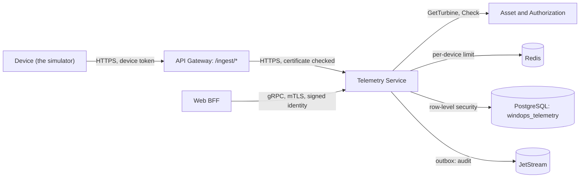

# windops-telemetry

Takes in each turbine's operational samples, as its device sends them, and keeps them by tenant and turbine
(FR-TEL-001, FR-TEL-002). Each device has its own credential, for one tenant and one turbine (FR-TEL-005). Fault
detection, data-quality labels, summaries and the fleet screens all read from it, as later modules add them.



## The device route (API-004)

`POST /ingest/v1/samples`, through the gateway, with `Authorization: Bearer <tenant>.<device>.<secret>` and a body of
`{"samples": [...]}`. Each sample is the simulator's schema version `2`; see
[windops-simulator](../../simulator/README.md#each-sample). The answer says how many were stored, and why each other
one was refused, by its place in the batch:

```json
{"accepted": 58, "rejected": [{"index": 12, "reason": "bad_event_time"}, {"index": 40, "reason": "not_json"}]}
```

| Answer | When |
| --- | --- |
| 200 | The batch was read. Samples that break the schema, or name another tenant or turbine, are refused one by one, and each refusal is kept with its reason and the start of what was sent (FR-TEL-003) |
| 401 `bad_credential` | No credential, a wrong or revoked one. Every way of failing gets the same answer |
| 429 `too_many_requests` | More than 600 requests in a minute from this device (SRS 7.5), with `Retry-After` |
| 503 `unavailable` | The rate counters cannot be reached, so the request is refused rather than let through |
| 400 `not_json`, `no_samples` | The body is not JSON, or has no `samples` list |
| 413 `too_large`, `too_many_samples` | More than 1 MiB, or more than 600 samples |

Errors are RFC 9457 problems, and never repeat what was sent. The route is served only over TLS, on port 8443: the
plain port, 8080, has health and metrics only. The gateway has no user sign-in on `/ingest/*`, only a coarse
per-address limit.

## What it stores

| Table | What |
| --- | --- |
| `operational_samples` | One row per sample: tenant, turbine, event time, sequence, the device, ingestion time, source, schema and model versions, `synthetic`, state, availability, quality status and the 12 readings. A reading is null while its sensor sends nothing. Quality status is `received` until data-quality detection labels it (M4.6) |
| `ingest_rejections` | Each refused sample, with its reason and at most 500 characters of what was sent |
| `device_credentials` | Each device's turbine, who made it, when, and when it was revoked. Only the secret's SHA-256 is kept |

Samples are partitioned by event time, a partition a day (ADR 0003). The service makes each day's partition from
yesterday to 3 days ahead, and checks every hour. A default partition holds anything outside them, so nothing is lost.
Every table and partition has forced row-level security, and a device's tenant comes from its credential, never from
what it sends.

## Device credentials

| Call | Needs |
| --- | --- |
| `CreateDeviceCredential` | `asset.manage` for the turbine's wind farm, and a second factor from the last 5 minutes. The turbine must exist in Asset. The token is in this first answer only: a retry with the same `idempotency_key` returns the credential without it |
| `ListDeviceCredentials` | `asset.manage` |
| `RevokeDeviceCredential` | As for making one. A revoked credential stops working at once |

Making and revoking a credential each queue an audit record. `make telemetry-devices` gives each demo turbine a
credential and keeps the tokens in the Secret `windops-simulator-devices`, for the simulator. It is safe to repeat:
a turbine whose token is in the Secret is skipped. The simulator's workload streams the whole demo fleet through
this route with those tokens; see [windops-simulator](../../simulator/README.md#streaming-live-m44).

## Still to come

- 10-minute summaries, CMS spectra and retention (M4.5), data-quality labels (M4.6), and reading telemetry and
  snapshots, `StreamTurbineTelemetry` and `CreateTelemetrySnapshot`, which answer UNIMPLEMENTED until M4.7.

## Run the tests

```bash
uv run pytest services/telemetry-service/tests
make telemetry-check   # on the cluster, after make telemetry-devices
```
