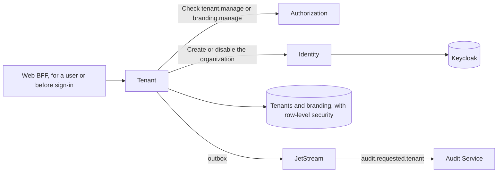

# windops-tenant

Tenants, their lifecycle, branding and settings (SRS 7.2, FR-TEN-001, FR-TEN-002).



## Who may do what

| Operation | Needs |
| --- | --- |
| Read a tenant, its branding, logo or email templates | Being in that tenant, as a user or a service. Another tenant needs `tenant.manage` |
| Change branding, the logo, email templates or the custom domain | `branding.manage`, held by the Tenant Administrator, and a recent second factor |
| Create, list, suspend or reactivate tenants | `tenant.manage`, held by the Platform Administrator, and a recent second factor |

Reading is open within a tenant because the sign-in page shows the branding before anyone signs in.

## Row-level security (DAT-005)

Every table here is tenant-owned. `windops-migrations` gives each one two FORCEd PostgreSQL policies, which bind
even the service's own login, and every transaction names its tenant first:

```python
async with engine.begin() as connection:
    await in_tenant(connection, tenant)
```

A query that forgets its `WHERE tenant_id = ...` then still sees one tenant's rows, and a write to another
tenant's row is refused by PostgreSQL. `ListTenants` is the only place that reads every tenant, with
`across_tenants`, and only for platform staff. `make tenant-check` asks PostgreSQL directly to prove this.

## Suspension

Suspending a tenant disables its Keycloak organization, through the Identity Service. I tested it on the cluster:
a user of a disabled organization can still sign in, but their token carries no `tenant_id`, so the gateway refuses
it from M3.7. Tokens issued before then keep working for up to 5 minutes.

## Branding rules

- **Logo:** PNG or JPEG, up to 256 KiB, and the bytes must match the type. SVG is refused, because it can carry
  scripts.
- **Colors:** lowercase hex. White text on the primary color must have a WCAG contrast of at least 4.5.
- **Email templates:** plain text, using only each template's own placeholders, such as `{{user_name}}`.
- **Custom domain:** one per tenant and one tenant per domain, with a token to prove control later. A domain
  another tenant holds gets the same refusal as a reserved one, so it names nobody.

## Check it

```bash
uv run pytest services/tenant-service/tests
make tenant-seed    # records the demo tenants
make tenant-check   # on the cluster
```

## Limits

- **Row-level security stops mistakes, not attackers.** It stops a query that forgets its tenant, but not code that
  names a tenant on purpose, or the service's own login used by hand.
- **The outbox has no row-level security.** Only the relay reads it, never a request.
- **Domains are not proven yet.** Custom domains are recorded, not proven or served. Proof by DNS TXT record, and
  serving a tenant at its domain, come with the gateway.
- **Tenant settings borrow `branding.manage`.** The SRS 3.2 matrix has no permission for tenant settings, so the
  time zone and locale use `branding.manage`.
- **No email server yet.** Email templates are stored for the Notification Service (Phase 11), which renders and
  sends them.
