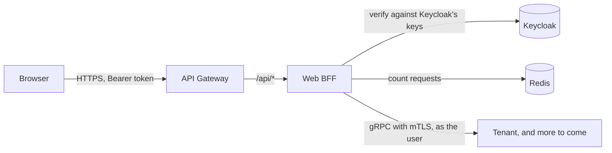

# windops-web-bff

The browser's REST API (SRS 7.2, API-002). It translates each request into gRPC calls to the services, and holds no
business rules of its own: permissions, tenancy and validation stay in the services.



## Every protected request

1. **Verify the token** against Keycloak's published keys: RS256 only, from the fixed issuer
   `https://localhost:9443/auth/realms/windops`, for the audience `windops-api`, not expired.
2. **Require one tenant.** Keycloak gives no `tenant_id` to a user of a suspended tenant, or one in two, so those
   tokens are refused (SEC-005).
3. **Apply the user's rate limit** (SRS 7.5): 120 requests a minute, or 300 for the administrators' client. If
   Redis is down, the request is refused with 503, never let through (SRS 7.7).
4. **Call services as the user**, with a signed internal identity that lasts 60 seconds. It copies the token's
   `acr` and `auth_time`, so a service can require a recent second factor (SEC-003).

## Answers

Errors are RFC 9457 problems, with `Content-Type: application/problem+json`.

Every word in an answer is Web BFF's own, from a fixed table, with a stable `code` the frontend can rely on. A
service's message is never forwarded, because the BFF is the edge and a message could carry something internal.

| From a service | To the browser |
| --- | --- |
| A recent second factor is needed | 401, code `step_up_required`, with `WWW-Authenticate: Bearer error="insufficient_user_authentication", acr_values="mfa"` (RFC 9470), so the frontend can ask for a code and retry |
| Permission denied, not found, invalid, conflict | 403, 404, 400 and 409, with codes `forbidden`, `not_found`, `invalid_request` and `conflict` |
| Unavailable, or anything unexpected | 503 `unavailable` or 502 `bad_gateway` |
| A refused token | 401, with codes such as `missing_token`, `invalid_token` or `no_tenant` |

## API

The versioned document is at `/api/v1/openapi.json`, and in [docs/api](../../docs/api/web-bff-v1.openapi.json),
which a test keeps the same as the code. Run `make openapi` after changing a route.

| Route | Sign-in | What |
| --- | --- | --- |
| `GET /api/v1/me` | Yes | Who is signed in |
| `GET /api/v1/tenant` | Yes | Their tenant |
| `GET /api/v1/branding` | Yes | Their tenant's branding |
| `GET /api/v1/public/branding/{tenant}` | No | A tenant's branding for its sign-in page, without the domain's proof token |
| `GET /api/v1/public/branding/{tenant}/logo` | No | Its logo, sent so a browser can never run it |

Routes for the administrator console arrive with M3.9.

## Check it

```bash
uv run pytest services/web-bff-service/tests
make bff-check   # on the cluster, with real logins through the gateway
```

## Limits

- **Plain HTTP from the gateway.** The gateway reaches Web BFF over plain HTTP inside the cluster. The next pull
  request adds gateway policy, and TLS on this hop.
- **Clients are trusted to report their own class.** The limit class comes from the client a user signed in
  through, not from their roles. The administrators' client requires a second factor, so only administrators can
  get the higher limit.
- **A fixed one-minute window.** A user can make up to twice their limit across a window's edge.
- **No field-level validation messages yet.** A 400 says only that the request is not valid, not which field. The
  fix is gRPC's structured error reasons (`ErrorInfo`), mapped to messages here, with the administrator console
  (M3.9).
- **No limits on public pages yet.** The public branding routes have no per-user limit. The gateway's per-address
  limits come in the next pull request.
