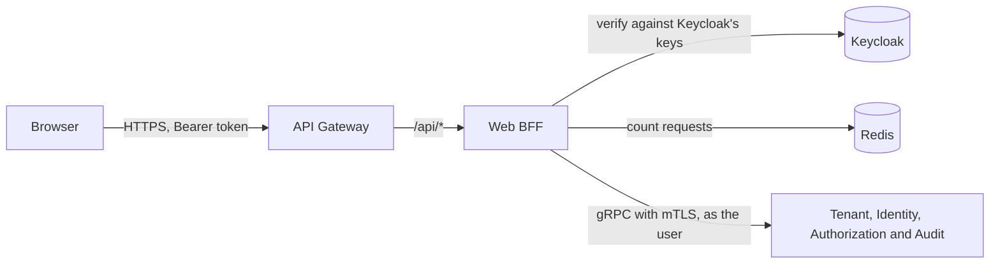

# windops-web-bff

The browser's REST API (SRS 7.2, API-002). It translates each request into gRPC calls to the services, and holds no
business rules of its own: permissions, tenancy and validation stay in the services.



## Every protected request

1. **Verify the token** against Keycloak's published keys: RS256 only, from the fixed issuer
   `$WINDOPS_PUBLIC_URL/auth/realms/$WINDOPS_KEYCLOAK_REALM`, for the audience `WINDOPS_OIDC_AUDIENCE`, not expired. Locally,
   that is `https://localhost:9443/auth/realms/windops` and `windops-api`.
2. **Require one tenant.** Keycloak gives no `tenant_id` to a user of a suspended tenant, or one in two, so those
   tokens are refused (SEC-005).
3. **Apply the user's rate limit** (SRS 7.5): 120 requests a minute, or 300 for the administrators' client. If
   Redis is down, the request is refused with 503, never let through (SRS 7.7).
4. **Call services as the user**, with a signed internal identity that lasts 60 seconds. It copies the token's
   `acr` and `auth_time`, so a service can require a recent second factor (SEC-003).

## Answers

Errors are RFC 9457 problems, with `Content-Type: application/problem+json`.

Every word in an answer is Web BFF's own, from a fixed table, with a stable `code` the frontend can rely on. A
service's message is never forwarded, because the BFF is the edge and a message could carry something internal.

| From a service | To the browser |
| --- | --- |
| A recent second factor is needed | 401, code `step_up_required`, with `WWW-Authenticate: Bearer error="insufficient_user_authentication", acr_values="mfa"` (RFC 9470), so the frontend can ask for a code and retry |
| Permission denied, not found, invalid, conflict | 403, 404, 400 and 409, with codes `forbidden`, `not_found`, `invalid_request` and `conflict` |
| A request that fails Web BFF's own checks, such as a missing `Idempotency-Key` | 422, code `invalid_request`, without repeating what was sent |
| Unavailable, or anything unexpected | 503 `unavailable` or 502 `bad_gateway` |
| A refused token | 401, with codes such as `missing_token`, `invalid_token` or `no_tenant` |

## API

The versioned document is at `/api/v1/openapi.json`, and in [docs/api](../../docs/api/web-bff-v1.openapi.json),
which a test keeps the same as the code. Run `make openapi` after changing a route.

| Route | Sign-in | What |
| --- | --- | --- |
| `GET /api/v1/me` | Yes | Who is signed in |
| `GET /api/v1/tenant` | Yes | Their tenant |
| `GET /api/v1/branding` | Yes | Their tenant's branding |
| `GET /api/v1/public/branding/{tenant}` | No | A tenant's branding for its sign-in page, without the domain's proof token |
| `GET /api/v1/public/branding/{tenant}/logo` | No | Its logo, sent so a browser can never run it |

### Administrator console (SRS 9.4)

Each route calls the service that owns the data, as the signed-in user, and that service decides. Identity needs
`users.manage`, Authorization `roles.manage` or `permissions.manage`, and Audit `audit.read`. Every change also
needs a recent second factor, so without one it gets the step-up answer above.

| Route | What |
| --- | --- |
| `GET /api/v1/admin/users` | The tenant's users, a page at a time |
| `POST /api/v1/admin/users` | Add a user. The temporary password is in the first answer only |
| `GET /api/v1/admin/users/{id}` | One user |
| `POST /api/v1/admin/users/{id}/disable` and `/reactivate` | Disable a user, which ends their sessions, or reactivate them |
| `GET /api/v1/admin/users/{id}/sessions` | Their sessions |
| `POST /api/v1/admin/users/{id}/sessions/revoke` | End all their sessions |
| `GET /api/v1/admin/users/{id}/mfa` | Whether they have set up a second factor |
| `GET /api/v1/admin/role-grants` | Who holds which role and where, optionally for one user and with ended grants |
| `POST /api/v1/admin/role-grants` | Give a role, in the whole tenant, a wind farm or a turbine |
| `POST /api/v1/admin/role-grants/{id}/revoke` | End a grant, which is kept |
| `GET` and `PUT /api/v1/admin/roles/{role}/permissions` | Read or replace what a role gives in this tenant |
| `GET /api/v1/admin/access-denials` | Refused attempts in this tenant, from the audit trail |

A tenant's own branding, for its administrators, needs `branding.manage`, which SRS 3.2 gives to Tenant
Administrators:

| Route | What |
| --- | --- |
| `GET`, `PUT /api/v1/admin/branding` | Read or replace the branding. Reading includes the custom domain's proof token, to publish |
| `PUT /api/v1/admin/branding/logo` | A PNG or JPEG as the body, at most 256 KiB. Anything else gets 415, and a bigger body 413 without being read in full |
| `GET /api/v1/admin/email-templates`, `PUT .../{template}` | The emails users get, and the placeholders each may use |
| `PUT`, `DELETE /api/v1/admin/custom-domain` | Set or remove the one custom domain |

### Platform console (M3.10)

For the Platform Administrator, across tenants. The Tenant Service needs `tenant.manage`, which only a Platform
Administrator holds, and Authorization allows break-glass only to one (RBAC-003). A tenant's branding is read-only
here, without the domain's proof token: its own administrators change it.

| Route | What |
| --- | --- |
| `GET`, `POST /api/v1/platform/tenants` | List tenants, or create one with its Keycloak organization |
| `GET /api/v1/platform/tenants/{id}` | One tenant |
| `POST /api/v1/platform/tenants/{id}/suspend`, `/reactivate` | Suspend, with a reason of at least 10 characters, or reactivate |
| `GET /api/v1/platform/tenants/{id}/branding` | Its branding and custom domain, to view |
| `GET`, `POST /api/v1/platform/break-glass` | Your own active grants, or start one: a reason of at least 20 characters, for 1 to 240 minutes |
| `POST /api/v1/platform/break-glass/{id}/end` | End one early |

Every change needs an `Idempotency-Key` header: a new random value per change, and the same one when resending it
(GRP-007). Web BFF never retries a change itself, so a new user's password cannot be lost to a retry. The browser
may resend with the same key.

## Metrics

For the Security dashboard (SRS 10.3), with fixed labels only:

| Metric | Counts |
| --- | --- |
| `windops_web_bff_tokens_refused_total{reason}` | Requests refused for their token: `missing`, `invalid`, `no_tenant` or `keys_unavailable` |
| `windops_web_bff_rate_limited_total{traffic_class}` | Requests over a user's limit, `standard` or `administrator` |

Each starts at 0 once telemetry is running, so Prometheus sees the first refusal.

## Check it

```bash
uv run pytest services/web-bff-service/tests
make bff-check         # on the cluster, with real logins through the gateway
make admin-api-check   # the administrator console's routes, the same way
make platform-api-check  # the Platform console's, as a Platform Administrator with a real code
```

## Limits

- **The gateway is not authenticated to the BFF.** The gateway reaches Web BFF over HTTPS on port 8443, and checks
  its certificate, but Web BFF does not ask the gateway for one. Another pod could call it directly and skip the
  gateway's CORS and per-address limits, though never its token checks, which Web BFF repeats. M13.3's network
  policies allow only the gateway to reach it.
- **Clients are trusted to report their own class.** The limit class comes from the client a user signed in
  through, not from their roles. The administrators' client requires a second factor, so only administrators can
  get the higher limit.
- **A fixed one-minute window.** A user can make up to twice their limit across a window's edge.
- **No field-level validation messages yet.** A 400 says only that the request is not valid, not which field. The
  fix is gRPC's structured error reasons (`ErrorInfo`), mapped to messages here. It is not done yet: the console's
  forms check their own fields first, so a 400 means something only a service can see.
- **The administrator console works in the caller's own tenant.** A Platform Administrator managing another tenant's
  users and roles, which the services allow, has no routes. Break-glass covers emergencies.
- **Public pages have only per-address limits.** The public branding routes have no per-user limit. The gateway
  allows 60 requests a minute from one address.
