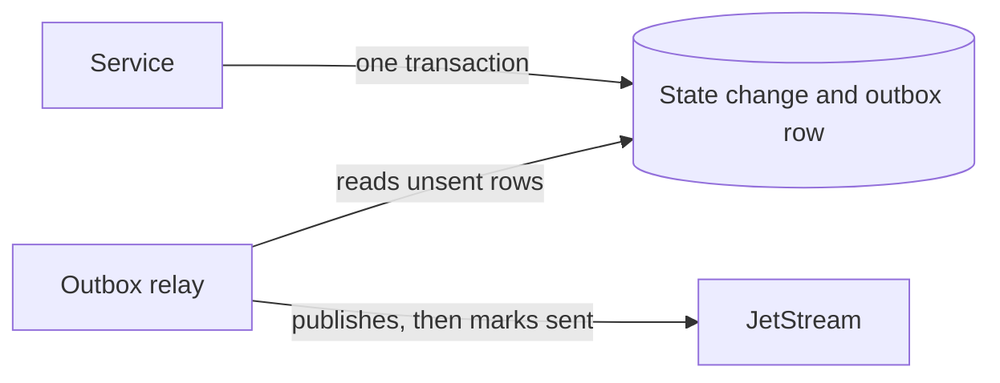

# windops-outbox

Commits a state change and its event together, so neither can happen without the other (EVT-002).

Without this, a service saves its data and then publishes. A crash between the two loses the event, and
publishing first can announce something that then fails to save.



## Add it to a service

Create the table in a migration, which `windops-migrations` accepts as an `expand` step:

```python
from windops_outbox import create_outbox_table


def upgrade() -> None:
    create_outbox_table(op.get_bind())
```

Then add the event in the same transaction as the state change:

```python
from windops_outbox import add_event

async with engine.begin() as connection:
    await connection.execute(insert(decisions).values(...))
    await add_event(
        connection,
        "approval.decided",
        tenant_id=identity.tenant_id,
        payload=payload,
        producer="approval",
    )
# Only now report success (EVT-004).
```

If the transaction rolls back, the event goes with it. `add_event` refuses a connection that is not in a
transaction, because the two writes would not then be together.

Run the relay in the service's background:

```python
relay = OutboxRelay(engine, publisher)
await relay.run_forever(stop)
```

## What happens when

| Situation | Result |
| --- | --- |
| The transaction rolls back | No event is sent |
| JetStream is down | State changes still commit. Events wait in the table, and the relay tries again (SRS 7.7) |
| The relay crashes after publishing, before marking the row sent | The event is sent again. JetStream drops a repeat within 2 minutes, and after that consumers must recognize `event_id` (EVT-003) |
| Two relays run | Each takes different rows, so a replica can fail safely |
| A stored row cannot be read | It is set aside with `failed_at`, and an error is logged, so it cannot block the rows behind it |

## Delivery order

One relay sends rows in order, and stops at the first failure so nothing overtakes it. **With two or more
relays, order is not guaranteed**, so a consumer that cares must use the identifiers and versions in the
event.

## Keep it healthy

- `outbox_status(connection)` returns the number of waiting and set-aside rows, and the age of the oldest. M2.8
  exports these as the outbox backlog metric and alert.
- `prune_published(connection, older_than=...)` removes sent rows. Keep them long enough to investigate a
  problem.

## Limits

- Delivery is at least once, so consumers must handle a repeat.
- The relay holds its row locks while publishing a batch. A batch is limited to 100 rows, and publishing
  stops quickly once the breaker opens.
- `tenant_id` is stored in each row, but the relay must read every tenant. M3.6 must allow this when it adds
  row-level security (DAT-005).
